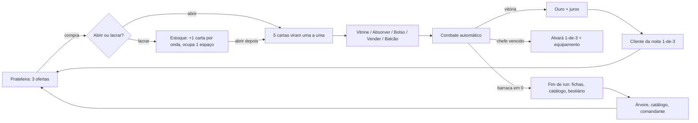
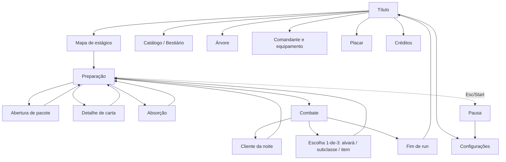
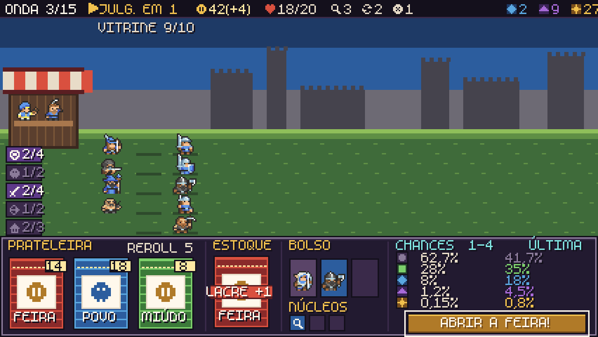
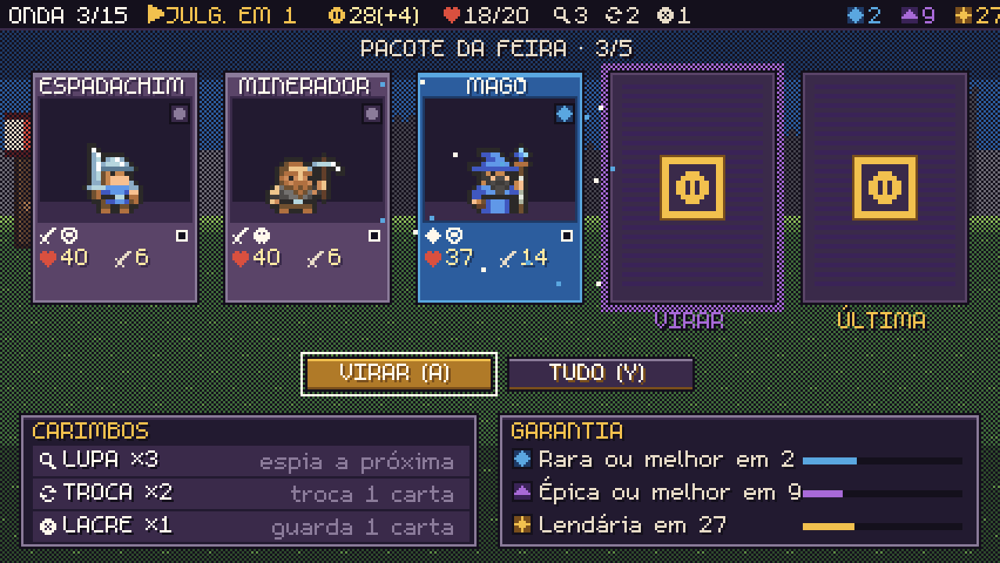
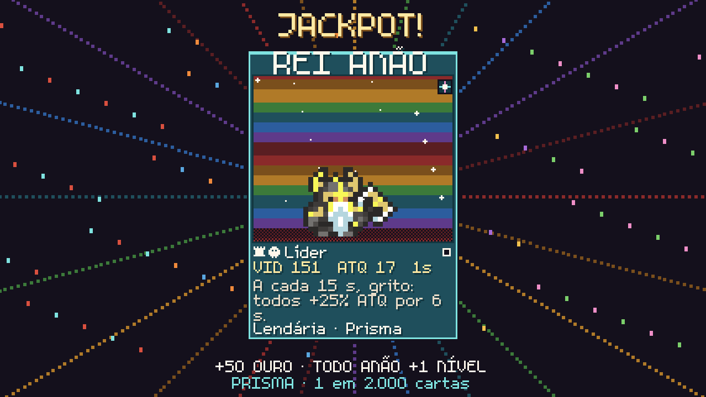
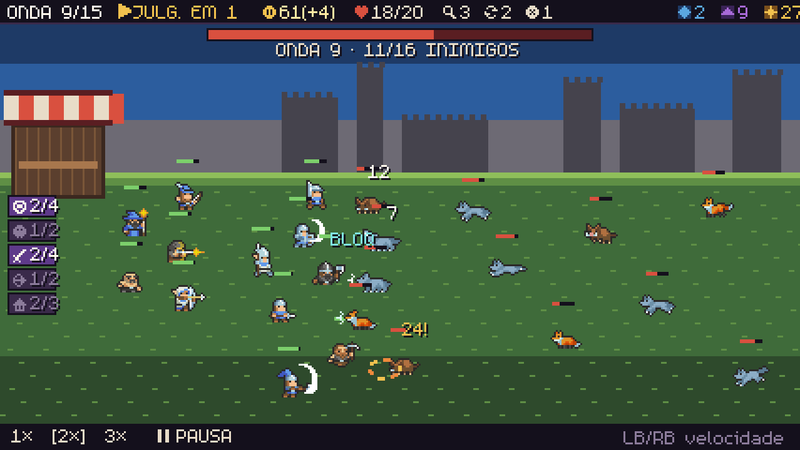
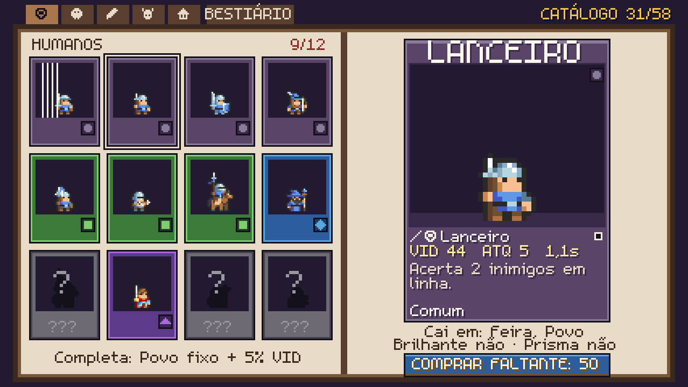
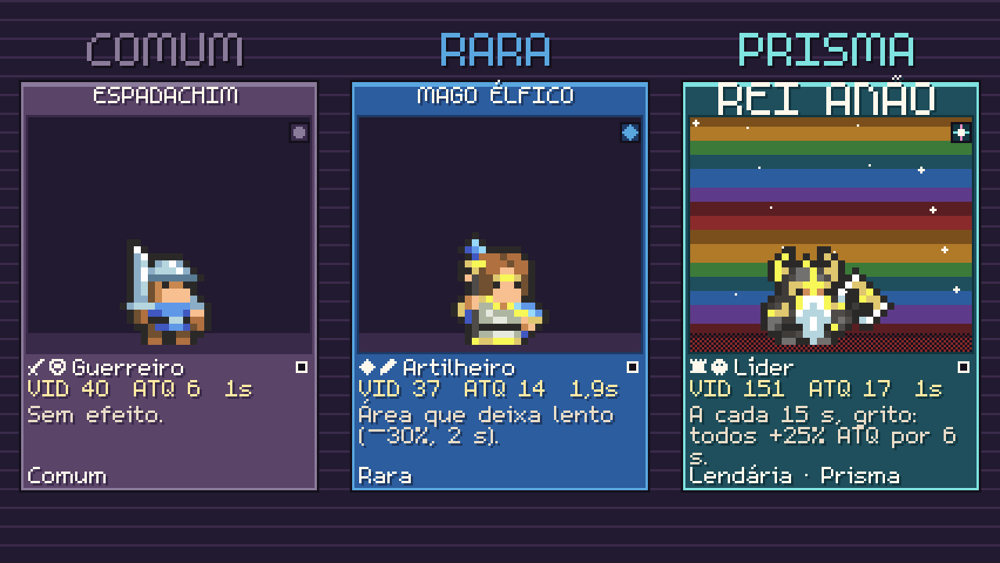

# Bazar das Ruínas — GDD

> **Este arquivo é gerado.** Edite `docs/gdd/GDD.fonte.md` e rode `node tools/gdd/montar_gdd.mjs`. As tabelas marcadas
> "(gerada)" saem de `data/*.json` — os mesmos arquivos que o jogo e as simulações usam. Números de balanceamento
> nunca são digitados aqui à mão.

Versão 0.1 — 21/11/2026. Conceito aprovado: **D — Bazar das Ruínas** (tema do B, com ideias de A e C; sem escavação,
trocada pelo **cliente da noite**). Escopo detalhado: **estágio 1 completo**; estágios 2–6 em resumo.
Nome provisório em inglês: **Ruin Bazaar**.

---

## 1. Visão, público e pilares

**Uma frase.** Roguelite de defesa com batalha automática em que você abre, especula e vende pacotes de cartas
MiniFolks para defender sua barraca numa feira acampada sobre ruínas.

**Público.**
- Primário: quem joga Slotbound, Balatro e roguelites curtos na Steam (sessões de 30–45 min, gosta de "quebrar" o jogo).
- Secundário: colecionadores de cartas digitais (Pokémon TCG Pocket, Marvel Snap) que querem abrir pacotes **sem pagar por eles**.
- Plataforma: PC Windows e Steam Deck; mouse, teclado ou controle.

**Pilares** (em conflito, vale a ordem):

| # | Pilar | Como medir |
|---|---|---|
| 1 | **Cada pacote é uma aposta legível.** Você sabe as chances, sente a carta virar e entende por que a run foi bem ou mal. | Painel de chances = tabela usada (teste automático); jogador explica a derrota no teste de usabilidade |
| 2 | **A barraca quebra a banca.** Facções, absorção, itens, núcleos e alvarás combinam em builds diferentes, com chefes que punem a build preguiçosa. | Simulação de 1.000 runs: nenhuma estratégia com taxa de vitória > 2× a média |
| 3 | **O catálogo sempre falta uma.** O álbum mostra o que falta e onde cai; cada carta nova muda algo na próxima run. | 50% do catálogo em ≤ 2 runs; 100% do estágio 1 em ~3–4 h |

---

## 2. Loops

| Escala | Duração | O que o jogador faz | Recompensa |
|---|---|---|---|
| **30 s** | um pacote | ler a prateleira → comprar → abrir agora ou lacrar → ver 5 cartas virarem → pôr cada uma na vitrine, absorver, guardar no bolso ou vender | cartas, combos, ouro, progresso de garantia |
| **Onda** | 2–3 min | preparação sem cronômetro (2–3 pacotes, posicionar, equipar) → combate automático 30–60 s → ouro e juros → cliente da noite (≤ 10 s) | unidades mais fortes, ouro, carimbos |
| **Run** | 30–45 min | 15 ondas: 10 normais, 3 julgamentos, 2 chefes; 1 alvará 1-de-3 por chefe | vitória ou derrota; fichas, cartas no catálogo, equipamento do comandante |
| **Meta** | semanas | gastar fichas na árvore, completar páginas do catálogo e do bestiário, liberar facções, comandantes, dificuldades, infinito e diário | poder permanente pequeno, novas opções de build |



---

## 3. Cartas

### 3.1 Tipos

| Tipo | Vai para | Exemplos | Ocupa espaço? |
|---|---|---|---|
| **Unidade** | vitrine (campo) | Espadachim, Rei Anão | 1 (pesado: 2) |
| **Especial (ajudante)** | balcão (3 → 5 espaços) | Mercador, Ladrão, Rainha da Feira | não ocupa a vitrine |
| **Item** | equipado numa unidade (1 por unidade) ou global (manuais) | Espada Afiada, Manual do Atirador | não |
| **Núcleo** | 3 encaixes de núcleo; muda os pacotes até o fim da run | Núcleo do Olho, Núcleo Prismático | não |
| **Amaldiçoada** | efeito imediato e forçado | Contrato Sombrio | não |

Toda carta pode ir para o **bolso** (3 espaços, decide depois) ou ser **vendida** na hora (ver §13).

### 3.2 Anatomia (carta na abertura: 72×100 px lógicos)

```
┌──────────────────────┐  ← moldura na cor da raridade; borda de 1 px no tom escuro da mesma rampa
│ ESPADACHIM       ●   │  ← nome (m5x7) + selo da raridade (forma + cor)
│┌────────────────────┐│
││                    ││  ← janela 64×64: sprite 32×32 ampliado 2× (pesados 40×40 e 64×32 em 1×, com selo "PESADO")
││        (sprite)    ││     o idle do MiniFolk anima dentro da carta
││                    ││
│└────────────────────┘│
│ ⚔ Guerreiro  [H] 1▢ │  ← ícone de classe · ícone de facção · custo de espaço
│ ♥40  ⚔6              │  ← na carta pequena só VID e ATQ com ícone (o efeito fica no detalhe e na dica)
└──────────────────────┘
```

No **detalhe da carta** (botão Y / clique direito) ela aparece em 3× (sprite 96×96) com todos os números,
as animações que a unidade tem, o nível, a estrela, a subclasse e o histórico de absorção.

### 3.3 Raridades e versões

| Raridade | Forma | Cor | Mult. atributos | XP ao absorver | Crédito de catálogo | Venda (× preço base da onda) |
|---|---|---|---|---|---|---|
| Comum | ● | `#8b7b9a` | ×1 | 1 | 1 | ×0.05 |
| Incomum | ■ | `#7ccf6b` | ×1.3 | 2 | 2 | ×0.1 |
| Rara | ◆ | `#5aa7e0` | ×1.7 | 4 | 5 | ×0.25 |
| Épica | ▲ | `#a86ad8` | ×2.2 | 8 | 12 | ×0.6 |
| Lendária | ★ | `#f2c14e` | ×2.9 | 16 | 30 | ×1.2 |


A raridade tem **forma e cor** (acessibilidade): o selo funciona também em escala de cinza.

| Versão | Chance por carta de unidade/ajudante | Bônus de atributos | Conta como cópias | Extra |
|---|---|---|---|---|
| Normal | 95,95% | +0% | 1 | — |
| Brilhante | 4% | +20% | 2 | — |
| Prisma | 0,05% | +50% | 4 | nasce no nível 4; jackpot: +50 ouro e todas as unidades da facção +1 nível |


- **Brilhante**: moldura com faixa de brilho que varre a carta a cada 3 s; na unidade, contorno claro de 1 px.
- **Prisma** (o jackpot): reflexo holográfico em faixas de cor que correm, partículas, flash e som próprio; ao entrar, paga o jackpot da tabela.

---

## 4. Pacotes

### 4.1 Tipos (gerada)

| Pacote | Cartas | Preço (× base) | Tabela da última carta | Peso na prateleira | Descrição |
|---|---|---|---|---|---|
| Pacote da Feira | 5 | 1 | ultima | 50 | 5 cartas de todas as facções liberadas. |
| Pacote Pequeno | 3 | 0.6 | ultima | 15 | 3 cartas, mais barato. |
| Pacote Grande | 7 | 1.6 | ultima | 12 | 7 cartas. |
| Pacote de Povo | 5 | 1.3 | ultima | 18 | 5 cartas; 80% das unidades de uma facção. |
| Pacote de Colecionador | 5 | 2.2 | colecionador | 5 (onda ≥ 6) | 5 cartas; a última é Rara ou melhor. |
| Pacote Antigo | 5 | troca (cliente) | antigo | 0 | Lacrado de outra era: raro, às vezes amaldiçoado. |


### 4.2 Tabelas de raridade por posição (gerada)

As cartas 1 até a penúltima usam `padrao`; a **última carta** usa a tabela do pacote (`ultima` no Pacote da Feira). É ela
que vira por último, com pausa e tambor (§16).

| Raridade | padrao | ultima | ultima_plus | colecionador | antigo |
|---|---|---|---|---|---|
| Comum | 62,65% | 41,7% | 0% | 0% | 0% |
| Incomum | 28% | 35% | 45% | 0% | 30% |
| Rara | 8% | 18% | 38% | 70% | 45% |
| Épica | 1,2% | 4,5% | 14% | 25% | 20% |
| Lendária | 0,15% | 0,8% | 3% | 5% | 5% |


### 4.3 Tipo de carta por posição (gerada)

| Tipo de carta | padrao | ultima | antigo |
|---|---|---|---|
| unidade | 72% | 70% | 60% |
| item | 14% | 12% | 14% |
| especial | 10% | 8% | 8% |
| nucleo | 4% | 10% | 8% |
| amaldicoada | 0% | 0% | 10% |


Regras do sorteio (nesta ordem):
1. Sorteia a raridade pela tabela da posição (aplicando a garantia na última carta, se for o caso).
2. Sorteia o tipo pela tabela de tipo.
3. Se não existir carta daquele tipo naquela raridade (ex.: núcleo Comum), **sobe** para a próxima raridade que tenha.
4. Sorteia a carta entre as do pool (facções liberadas e pesos de núcleos); no Pacote de Povo, 80% das unidades vêm da facção alvo.
5. Unidades e ajudantes sorteiam a versão (Brilhante 4%, Prisma 0,05%).

### 4.4 Prateleira, quantidade e preço

- **Prateleira**: 3 ofertas por onda (mínimo 1 Pacote da Feira), sorteadas pelos pesos da §4.1. Reroll: 5 ouro, +5 a cada novo reroll na mesma onda.
- **Limite**: 3 pacotes comprados por onda (+1 Rainha da Feira, +1 Carta Branca, +1 árvore; máximo 5).
- **Preço** = arred((8 + 2 × onda) × mult. do tipo × escada), com escada **1; 1,5; 2,2; 3,0; 4,0** para o 1º…5º pacote **da onda** (qualquer tipo).
- **Lacrar**: em vez de abrir, o pacote vai para o estoque, ocupa **1 espaço da vitrine** e ganha **+1 carta por onda** guardado (até o tamanho +2). Abrir um lacrado não conta no limite da onda.

### 4.5 Revelação uma a uma

1. Toca o pacote (ou A): ele treme, rasga pela linha pontilhada, as cartas saem de costas em leque.
2. Antes de virar, cada verso **brilha na cor da raridade** por 0,4 s (comum não brilha). É o suspense: o jogador lê o brilho antes de ver a carta.
3. Vira com A/clique (ou "virar tudo"). A **última carta** tem pausa de 0,6 s e rufar de tambor; se for Épica+ ou Prisma, a tela escurece antes.
4. Depois da última: confere combos (§4.6) e mostra o resumo; o jogador distribui as cartas.

### 4.6 Combos dentro do pacote (gerada)

| Combo | Condição | Efeito |
|---|---|---|
| Par | 2 cartas do mesmo personagem | 2 iguais viram 1 unidade com +1 nível. |
| Trinca | 3+ cartas do mesmo personagem | 3 iguais viram 1 unidade com +3 níveis e +10 ouro. |
| Povo Unido | 4+ unidades da mesma facção | 4+ da mesma facção: +12 ouro e +1 tipo na sinergia nesta onda. |
| Caravana | 4+ facções diferentes (unidades e ajudantes) | 4+ facções diferentes: +1 carga de carimbo. |
| Escada | 4 raridades diferentes | 4 raridades diferentes: próximo pacote −30%. |
| Mão Dourada | 2+ cartas Épica ou melhor | 2+ Épicas ou melhores: +25 ouro. |


### 4.7 Manipulações — carimbos (gerada)

| Carimbo | Cargas iniciais | Máximo | Uso |
|---|---|---|---|
| Lupa | 3 | 5 | Antes de virar: mostra a próxima carta. Na prateleira: mostra a última carta de 1 pacote. |
| Troca | 2 | 4 | Depois de virar: sorteia de novo 1 carta, mesmo tipo e mesma raridade. |
| Lacre | 1 | 3 | Depois de virar: guarda 1 carta (máx. 1 guardada); ela entra como 1ª carta do próximo pacote aberto. |


Recarga: +1 carga (à escolha) por chefe ou julgamento vencido e pelo combo Caravana.

### 4.8 Garantia contra azar (gerada)

| Garantia | Dispara depois de | Garante na última carta | Escopo do contador |
|---|---|---|---|
| rara | 3 pacotes seguidos sem rara ou melhor | Rara ou melhor | run |
| epica | 12 pacotes seguidos sem epica ou melhor | Épica ou melhor | run |
| lendaria | 40 pacotes seguidos sem lendaria ou melhor | Lendária ou melhor | perfil |


O painel do pacote mostra sempre: **"Rara garantida em N · Épica em N · Lendária em N"**. O contador da Lendária é do
perfil (atravessa runs); os outros zeram no começo de cada run.

### 4.9 O que muda os pacotes

- **Núcleos** (§6.4): pesos de facção, tamanho, tabela da última carta, chance de Brilhante/Prisma, preço, visão da última carta.
- **Ajudantes** (§5.4): preço (Mercador), carta extra (Ladrão), +1 carta no Pacote de Povo (Princesa), ver a última carta (Mercador Suspeito).
- **Alvarás** (§10.3): Licença Dourada, Carta Branca, Alvará de Estoque, Balança Viciada.
- **Catálogo** (§12): página completa deixa o Pacote de Povo daquela facção fixo na prateleira.

### 4.10 Simulação de 1.000.000 de pacotes

Semente 20261121; pool do estágio 1 (Humanos, Anões, Elfos, Vikings, Aldeões, itens, núcleos); garantias de run zeradas a cada 39 pacotes (uma run típica). Tempo: 4.4 s. Gerado por `tools/sim/simular_pacotes.mjs`.

## Raridade sorteada por posição (tabela declarada × observado)

| Raridade | Cartas 1–4: tabela | observado | Última carta: tabela | observado |
|---|---|---|---|---|
| comum | 62.6% | 62.652% | 41.7% | 41.665% |
| incomum | 28.0% | 27.995% | 35.0% | 34.983% |
| rara | 8.0% | 8.002% | 18.0% | 18.050% |
| epica | 1.2% | 1.197% | 4.5% | 4.519% |
| lendaria | 0.1% | 0.153% | 0.8% | 0.783% |

Na coluna "última carta" ficam de fora as 96.703 últimas cartas sorteadas pela garantia (9.670%).

## Tipo de carta por posição

| Tipo | Cartas 1–4: tabela | observado | Última: tabela | observado |
|---|---|---|---|---|
| unidade | 72.0% | 71.994% | 70.0% | 70.097% |
| item | 14.0% | 14.018% | 12.0% | 11.945% |
| especial | 10.0% | 9.984% | 8.0% | 7.994% |
| nucleo | 4.0% | 4.004% | 10.0% | 9.963% |

## Por pacote

| Pelo menos uma… | Sem garantia (cálculo) | Com garantia (observado) | 1 a cada |
|---|---|---|---|
| rara ou melhor | 48.21% | 53.24% | 1.9 pacotes |
| epica ou melhor | 10.31% | 14.69% | 6.8 pacotes |
| lendaria ou melhor | 1.39% | 3.42% | 29.2 pacotes |

## Garantias

| Garantia | Regra | Disparou | % dos pacotes | Maior seca observada (dentro da run p/ rara e épica) |
|---|---|---|---|---|
| rara | 3 pacotes sem → garante (run) | 58.739 | 5.874% | 3 pacotes |
| epica | 12 pacotes sem → garante (run) | 22.082 | 2.208% | 12 pacotes |
| lendaria | 40 pacotes sem → garante (perfil) | 15.882 | 1.588% | 40 pacotes |

## Versões (unidades e ajudantes)

| Versão | Tabela | Observado | 1 a cada |
|---|---|---|---|
| brilhante | 4.00% | 4.005% | 25 cartas (6 pacotes) |
| prisma | 0.05% | 0.050% | 2.010 cartas (495 pacotes) |

## Raridade efetiva (depois da regra "sem carta desse tipo nessa raridade → sobe")

| Raridade | % de todas as cartas |
|---|---|
| comum | 54.900% |
| incomum | 31.465% |
| rara | 10.572% |
| epica | 2.375% |
| lendaria | 0.688% |


Conclusões: o observado bate com a tabela (diferença ≤ 0,05 ponto percentual em todas as linhas); a **maior seca é
exatamente o limite da garantia** (3, 12 e 40 pacotes), ou seja, a garantia dispara sempre no pacote certo. Numa run de
~35 pacotes saem em média **~18 Raras+, ~5 Épicas+ e ~1,2 Lendária**; Prisma é 1 a cada ~495 pacotes (~1 a cada 14 runs).

---

## 5. Unidades

### 5.1 Facções

O jogo usa **16 facções** dos 17 packs (Villagers e Villagers 2 viram uma só, Aldeões). No estágio 1, o jogador recruta
Humanos, Anões, Elfos e Vikings e contrata Aldeões como ajudantes; Gosmas, Bichos do Vale e Bandidos são inimigos.
As outras facções entram como inimigos nos estágios 2–6 e viram recrutáveis quando o bestiário delas é completado (§12).

| Facção | Pack | Cartas | Tipos únicos 2 / 4 / 6 | Liberação |
|---|---|---|---|---|
| Humanos | humans | 12 | 2: +10% · 4: +20% · 6: +35% (vid) | inicial |
| Anões | dwarfs | 10 | 2: +8% · 4: +16% · 6: +28% (reducao dano) | inicial |
| Elfos | elves | 10 | 2: +15% · 4: +30% · 6: +50% (atq atiradores e magos) | run 1 concluida |
| Vikings | vikings | 6 | 2: +15% · 4: +30% · 6: +50% (furia abaixo 50pct) | vencer mae gosma |
| Aldeões | villagers+villagers2 | 20 | 3: +2 · 5: +5 (ouro por onda) | inicial |


Sinergia de facção conta **tipos únicos** em campo (duas cópias do Espadachim contam 1).

### 5.2 Classes (gerada)

Atributo = base × classe × raridade × (1 + 0,12 × (nível − 1)), arredondado. Base: VID 40, ATQ 6, intervalo 1,0 s, alcance 14 px, velocidade 22 px/s.

| Classe | VID | ATQ | Intervalo (s) | Alcance (px) | Velocidade (px/s) | Raio de guarda | Espaços | Particularidade | Sinergia 2 / 4 |
|---|---|---|---|---|---|---|---|---|---|
| Guerreiro | ×1 | ×1 | 1 | 14 | 22 | 60 | 1 | — | atq +10% / atq +25% |
| Defensor | ×1.6 | ×0.6 | 1.1 | 14 | 18 | 45 | 1 | bloqueia 25% | bloqueio +10% / bloqueio +20%, provoca  |
| Lanceiro | ×1.1 | ×0.9 | 1.1 | 24 | 20 | 55 | 1 | 2 alvos | alvos +1 / alvos +2, atq +10% |
| Atirador | ×0.6 | ×1 | 1.4 | 110 | 20 | fica no lugar | 1 | — | cad +10% / cad +25%, alc +20 |
| Artilheiro | ×0.55 | ×1.4 | 1.9 | 90 | 18 | fica no lugar | 1 | área 18 px | area_raio +4 / area_raio +8, atq +15% |
| Cavaleiro | ×1.2 | ×1.1 | 1 | 16 | 40 | 90 | 1 | investida ×2 | investida_mult +50% / investida_mult +1, vel +20% |
| Bruto | ×2.2 | ×1.8 | 1.5 | 18 | 16 | 50 | 2 | pesado | vid +15% / vid +30%, atordoar_s +60% |
| Líder | ×1.3 | ×1 | 1 | 14 | 22 | 40 | 1 | aura 50 px | aura +5% / aura +10% |


### 5.3 As 38 unidades do estágio 1 (gerada)

Cada unidade usa **só animações que existem** no sprite dela (o gerador confere contra `assets/minifolks/manifest.json` e
falha se faltar alguma). Atributos no nível 1, versão normal.

| Carta | Sprite (pack/arquivo) | Tam. | Facção | Classe | Raridade | Esp. | VID | ATQ | Int. s | Alc. | Vel. | Animações usadas | Efeito |
|---|---|---|---|---|---|---|---|---|---|---|---|---|---|
| Espadachim | `humans/sword` | 32×32 | Humanos | Guerreiro | Comum | 1 | 40 | 6 | 1 | 14 | 22 | idle, walk, attack, hit, death | Sem efeito. |
| Lanceiro | `humans/spear` | 32×32 | Humanos | Lanceiro | Comum | 1 | 44 | 5 | 1.1 | 24 | 20 | idle, walk, attack, hit, death | Acerta 2 inimigos em linha. |
| Escudeiro | `humans/shield` | 32×32 | Humanos | Defensor | Comum | 1 | 64 | 4 | 1.1 | 14 | 18 | idle, walk, attack, block, hit, death | 25% de bloquear um golpe. |
| Arqueiro | `humans/archer` | 32×32 | Humanos | Atirador | Comum | 1 | 24 | 6 | 1.4 | 110 | 20 | idle, walk, attack, attack2, hit, death | Se encostarem nele, troca para golpe curto. |
| Alabardeiro | `humans/halberd` | 32×32 | Humanos | Lanceiro | Incomum | 1 | 57 | 7 | 1.1 | 24 | 20 | idle, walk, attack, hit, death | Golpe em arco: 3 alvos. |
| Besteiro | `humans/crossbow` | 32×32 | Humanos | Atirador | Incomum | 1 | 31 | 8 | 1.4 | 110 | 20 | idle, walk, attack, attack2, hit, death | O virote atravessa 1 inimigo. |
| Cavaleiro | `humans/horse` | 32×32 | Humanos | Cavaleiro | Incomum | 1 | 62 | 9 | 1 | 16 | 40 | idle, walk, attack, hit, death | Investida: 1º golpe ×2. |
| Mago | `humans/mage` | 32×32 | Humanos | Artilheiro | Rara | 1 | 37 | 14 | 1.9 | 90 | 18 | idle, walk, attack, spell, hit, death | Bola de fogo em área que queima por 3 s. |
| Cavaleiro Real | `humans/cavalier` | 32×32 | Humanos | Cavaleiro | Rara | 1 | 82 | 11 | 1 | 16 | 40 | idle, walk, attack, hit, death | Investida que atordoa 0,8 s. |
| Príncipe | `humans/prince` | 32×32 | Humanos | Líder | Épica | 1 | 114 | 13 | 1 | 14 | 22 | idle, walk, attack, hit, death | Aura: Humanos +15% ATQ. |
| Arquimago | `humans/archmage` | 32×32 | Humanos | Artilheiro | Épica | 1 | 48 | 18 | 1.9 | 90 | 18 | idle, walk, attack, spell2, hit, death | A cada 8 s, meteoro (×3 ATQ, raio 30). |
| Rei | `humans/king` | 32×32 | Humanos | Líder | Lendária | 1 | 151 | 17 | 1 | 14 | 22 | idle, walk, attack, hit, death | Humanos +20% VID. Ao entrar: todo Humano +1 nível. |
| Minerador | `dwarfs/dwarfminer` | 32×32 | Anões | Guerreiro | Comum | 1 | 40 | 6 | 1 | 14 | 22 | idle, walk, attack, hit, death | +1 ouro por abate. |
| Guerreiro Anão | `dwarfs/dwarfwarrior` | 32×32 | Anões | Guerreiro | Comum | 1 | 40 | 6 | 1 | 14 | 22 | idle, walk, attack, hit, death | Sem efeito. |
| Caçador Anão | `dwarfs/dwarfhunter` | 32×32 | Anões | Atirador | Comum | 1 | 24 | 6 | 1.4 | 110 | 20 | idle, walk, attack, attack2, hit, death | Golpe curto quando encurralado. |
| Quebra-escudos | `dwarfs/dwarfshieldbreaker` | 32×32 | Anões | Defensor | Incomum | 1 | 83 | 5 | 1.1 | 14 | 18 | idle, walk, attack, block, hit, death | Bloqueia 25%; ignora 30% da defesa do alvo. |
| Fuzileiro | `dwarfs/dwarfrifle` | 32×32 | Anões | Atirador | Incomum | 1 | 31 | 8 | 1.4 | 140 | 20 | idle, walk, attack, attack2, hit, death | Alcance 140. |
| Granadeiro | `dwarfs/dwarfgrenadier` | 32×32 | Anões | Artilheiro | Incomum | 1 | 29 | 11 | 1.9 | 90 | 18 | idle, walk, attack, hit, death | Granada em área. |
| Cavaleiro de Urso | `dwarfs/dwarfbearrider` | 32×32 | Anões | Bruto | Rara | 2 | 150 | 18 | 1.5 | 18 | 16 | idle, walk, attack, attack2, hit, death | Pesado (2 espaços). |
| Demolidor | `dwarfs/dwarfdemolitionist` | 32×32 | Anões | Artilheiro | Rara | 1 | 37 | 14 | 1.9 | 90 | 18 | idle, walk, attack, barrel, hit, death | A cada 10 s, barril (×4 ATQ, raio 28). |
| Urso Encouraçado | `dwarfs/dwarfarmoredbearrider` | 32×32 | Anões | Bruto | Épica | 2 | 194 | 24 | 1.5 | 18 | 16 | idle, walk, attack, hit, death | Pesado. Recebe 30% menos dano. |
| Rei Anão | `dwarfs/dwarfking` | 32×32 | Anões | Líder | Lendária | 1 | 151 | 17 | 1 | 14 | 22 | idle, walk, attack, warcry, hit, death | A cada 15 s, grito: todos +25% ATQ por 6 s. |
| Lanceiro Élfico | `elves/elfspear` | 32×32 | Elfos | Lanceiro | Comum | 1 | 44 | 5 | 1.1 | 24 | 20 | idle, walk, attack, hit, death | Acerta 2 em linha. |
| Espadachim Élfico | `elves/elfsword` | 32×32 | Elfos | Guerreiro | Comum | 1 | 40 | 6 | 1 | 14 | 22 | idle, walk, attack, attack2, hit, death | A cada 3º golpe, golpe duplo ×1,5. |
| Arqueiro Élfico | `elves/elfarcher` | 32×32 | Elfos | Atirador | Comum | 1 | 24 | 6 | 1.4 | 110 | 20 | idle, walk, attack, attack2, hit, death | Golpe curto quando encurralado. |
| Guardião Élfico | `elves/elfwarden` | 32×32 | Elfos | Defensor | Incomum | 1 | 83 | 5 | 1.1 | 14 | 18 | idle, walk, attack, block, hit, death | Bloqueia 25%; ao bloquear, devolve 20%. |
| Cavaleiro Élfico | `elves/elfhorse` | 32×32 | Elfos | Cavaleiro | Incomum | 1 | 62 | 9 | 1 | 16 | 40 | idle, walk, attack, hit, death | Investida ×2. |
| Arqueiro Arcano | `elves/elfarcanearcher` | 32×32 | Elfos | Atirador | Rara | 1 | 41 | 10 | 1.4 | 110 | 20 | idle, walk, attack, attack2, hit, death | Flecha atravessa 2 inimigos. |
| Mago Élfico | `elves/elfmage` | 32×32 | Elfos | Artilheiro | Rara | 1 | 37 | 14 | 1.9 | 90 | 18 | idle, walk, attack, spell, attack_melee, hit, death | Área que deixa lento (−30%, 2 s). |
| Lâmina Arcana | `elves/elfspellsword` | 32×32 | Elfos | Guerreiro | Épica | 1 | 88 | 13 | 1 | 14 | 22 | idle, walk, attack, spell, hit, death | A cada 4º golpe, onda arcana (×2, 60 px). |
| Cavaleira de Pégaso | `elves/elfpegasusrider` | 32×32 | Elfos | Cavaleiro | Épica | 1 | 106 | 15 | 1 | 16 | 40 | idle, walk, attack, fly, hit, death | Voa: ignora a linha de frente e caça atiradores. |
| Rainha Élfica | `elves/elfqueen` | 32×32 | Elfos | Líder | Lendária | 1 | 151 | 17 | 1 | 14 | 22 | idle, walk, attack, spell, hit, death | A cada 6 s cura 15% (raio 70). Elfos +20 alcance. |
| Espadachim Viking | `vikings/vikingsword` | 32×32 | Vikings | Defensor | Comum | 1 | 64 | 4 | 1.1 | 14 | 18 | idle, walk, attack, block, hit, death | Bloqueia 25%. |
| Lanceiro Viking | `vikings/vikingspear` | 32×32 | Vikings | Lanceiro | Comum | 1 | 44 | 5 | 1.1 | 24 | 20 | idle, walk, attack, hit, death | Acerta 2 em linha. |
| Arqueiro Viking | `vikings/vikingarcher` | 32×32 | Vikings | Atirador | Incomum | 1 | 31 | 8 | 1.4 | 110 | 20 | idle, walk, attack, attack2, hit, death | Golpe curto quando encurralado. |
| Cavaleiro Viking | `vikings/vikinghorse` | 32×32 | Vikings | Cavaleiro | Rara | 1 | 82 | 11 | 1 | 16 | 40 | idle, walk, attack, hit, death | Investida que faz sangrar 4 s. |
| Berserker | `vikings/vikingberserker` | 32×32 | Vikings | Guerreiro | Épica | 1 | 88 | 13 | 1 | 14 | 22 | idle, walk, attack, throw, rage, hit, death | Arremessa machado (70 px). Abaixo de 50% VID: +50% cadência. |
| Jarl | `vikings/vikingjarl` | 32×32 | Vikings | Líder | Lendária | 1 | 151 | 17 | 1 | 14 | 22 | idle, walk, attack, warcry, hit, death | A cada 12 s: todos +20% ATQ e curam 10%. |


### 5.4 Os 20 ajudantes Aldeões (gerada)

Ficam no **balcão** da barraca (3 espaços, até 5), animando o trabalho (`work`, `idle_b`, `steal`, `skinning`); não lutam.
Sinergia de Aldeões: 3 tipos = +2 ouro por onda; 5 tipos = +5.

| Ajudante | Sprite | Raridade | Animação no balcão | Efeito |
|---|---|---|---|---|
| Aldeão | `villagers/villager` | Comum | idle | +2 ouro por onda. |
| Aldeã | `villagers/villagerwo` | Comum | idle | +2 ouro por onda. |
| Mineiro | `villagers2/miner` | Comum | work | +4 ouro por onda. |
| Coveiro | `villagers2/gravedigger` | Comum | work | +3 ouro quando uma unidade sua cai. |
| Caçador | `villagers2/hunter` | Comum | skinning | +2 ouro por bicho abatido. |
| Lenhador | `villagers2/lumberjack` | Comum | work | Conserta a barraca: +1 vida por onda (até o máximo). |
| Velho Contador | `villagers/old` | Comum | idle | Absorção dá +15% XP. |
| Avó da Feira | `villagers/oldwo` | Comum | idle | +1 ficha da feira por onda vencida. |
| Construtor | `villagers/worker` | Incomum | work | Barraca +3 vida máxima. |
| Mercador | `villagers2/merchant` | Incomum | idle_b | Pacotes 10% mais baratos. |
| Freira | `villagers2/nun` | Incomum | idle_b | A primeira unidade que cairia em cada onda fica com 1 VID. |
| Coletora | `villagers2/gatherer` | Rara | work | +1 carga de carimbo a cada 3 ondas. |
| Ferreiro | `villagers2/blacksmith` | Rara | work | Itens equipados +25% de efeito. |
| Mercador Suspeito | `villagers2/suspiciousmerchant` | Rara | idle_b | Mostra a última carta de cada pacote na prateleira. |
| Nobre | `villagers/noble` | Rara | idle | Juros máximos +3. |
| Dama Nobre | `villagers/noblewo` | Rara | idle | Pacote de Colecionador aparece mais (+15%) e custa 20% menos. |
| Camponês Valente | `villagers/peasant` | Épica | idle | +1 espaço na vitrine. |
| Ladrão | `villagers2/thief` | Épica | steal | 1 vez por onda, o próximo pacote vem com +1 carta. |
| Princesa | `villagers/princess` | Épica | idle | Pacotes de Povo +1 carta. |
| Rainha da Feira | `villagers/queen` | Lendária | idle | +1 pacote por onda. |


### 5.5 Traços e limite do campo

- **Pesado**: classe Bruto e sprites maiores que 32×32 ocupam **2 espaços**.
- **Vitrine** (limite do campo): **8 espaços** no início, +1 nas ondas 5 e 10, +1/+1 na árvore, +1 Camponês, +2 Mercenários; **máximo 14**. Pacote lacrado ocupa 1.
- Se o exército + lacrados passarem do limite, **a prateleira trava** ("Vitrine cheia") até vender, absorver ou abrir/vender um lacrado.
- Posições: 3 colunas (frente x=132, meio x=106, fundo x=80) × 5 linhas (y 110–166, a cada 14 px, acima do painel de baixo da preparação); corpo a corpo vai para a frente, atiradores e artilheiros para o fundo (o jogador pode arrastar).

---

## 6. Absorção e evolução

### 6.1 Níveis e estrelas (gerada)

| Nível | 1 | 2 | 3 | 4 | 5 | 6 | 7 | 8 | 9 |
|---|---|---|---|---|---|---|---|---|---|
| XP para o próximo | 2 | 3 | 3 | 4 | 4 | 5 | 5 | 6 | — |
| Estrelas | ★ | ★ | ★ | ★★ | ★★ | ★★ | ★★★ | ★★★ | ★★★ |
| Espadachim Comum VID | 40 | 45 | 50 | 54 | 59 | 64 | 69 | 74 | 78 |
| Espadachim Comum ATQ | 6 | 7 | 7 | 8 | 9 | 10 | 10 | 11 | 12 |


- **XP de uma carta absorvida** = XP da raridade (§3.3) × 2 se for o **mesmo personagem** × 2 Brilhante (× 4 Prisma) + 1 por nível acima de 1 da unidade absorvida.
- Absorver: arrastar a carta (ou a unidade em campo) sobre a unidade alvo, ou no detalhe da unidade "Alimentar" → escolher cartas. A pré-visualização mostra o nível final antes de confirmar.
- **Trava** (cadeado): unidade travada não pode ser alimento nem vendida; ícone de cadeado no canto da carta.

### 6.2 Marcos

| Marco | Nível | O que acontece |
|---|---|---|
| ★2 | 4 | **Subclasse 1-de-2** (tabela abaixo) |
| ★3 | 7 | **Herdar efeito**: escolhe 1 efeito entre as cartas que ela absorveu nesta run (o efeito, não os atributos) |
| Mestre | 9 | +1 tipo na sinergia da classe dela |

| Classe | Opção A | Opção B |
|---|---|---|
| Guerreiro | **Duelista** — 15% crítico; +30% contra alvo isolado. | **Vigia** — +40% VID e atrai inimigos. |
| Defensor | **Muralha** — +20% bloqueio. | **Espinhoso** — Devolve 25% do dano recebido. |
| Lanceiro | **Falange** — +1 alvo. | **Perfurador** — Ignora 30% da defesa. |
| Atirador | **Atirador de Elite** — +40 alcance, 20% crítico. | **Rajada** — +35% cadência. |
| Artilheiro | **Bombardeiro** — Área +50%. | **Piromante** — Queimadura ×2. |
| Cavaleiro | **Choque** — Investida +1×. | **Batedor** — +50% velocidade; caça a retaguarda. |
| Bruto | **Colosso** — +50% VID; a cada 4 golpes atordoa 0,5 s. | **Esmagador** — +40% ATQ; golpe em área 12 px. |
| Líder | **Comandante** — Raio da aura +50%. | **Estandarte** — Aura também dá +10% VID. |


### 6.3 Itens e manuais (gerada)

Itens de unidade: 1 por unidade; equipar outro descarta o antigo. Manuais são globais e acumulam até 3.

| Item | Raridade | Alvo | Efeito |
|---|---|---|---|
| Espada Afiada | Comum | unidade | +25% ATQ. |
| Escudo de Carvalho | Comum | unidade | +40% VID. |
| Botas Leves | Comum | unidade | +30% velocidade, +10% cadência. |
| Arco Longo | Incomum | atirador | Atirador: +30 alcance, +10% ATQ. |
| Elmo de Ferro | Incomum | unidade | Recebe 15% menos dano. |
| Tomo de Fogo | Incomum | unidade | Golpes queimam (3 s). |
| Presa de Javali | Incomum | unidade | Golpes envenenam (acumula 3×). |
| Amuleto Vampírico | Rara | unidade | Cura 12% do dano causado. |
| Trompa de Guerra | Rara | lider | Líder: aura +50% mais forte. |
| Lança Real | Rara | cavaleiro | Cavaleiro: investida ×3 e atordoa 0,5 s. |
| Coroa Velha | Épica | unidade | +2 níveis. |
| Pena de Fênix | Lendária | unidade | Revive 1 vez por onda com 50% VID. |
| Manual do Guerreiro | Incomum | global | Todo Guerreiro: +15% ATQ e VID (acumula até 3). |
| Manual do Defensor | Incomum | global | Todo Defensor: +15% ATQ e VID (acumula até 3). |
| Manual do Lanceiro | Incomum | global | Todo Lanceiro: +15% ATQ e VID (acumula até 3). |
| Manual do Atirador | Incomum | global | Todo Atirador: +15% ATQ e VID (acumula até 3). |
| Manual do Artilheiro | Incomum | global | Todo Artilheiro: +15% ATQ e VID (acumula até 3). |
| Manual do Cavaleiro | Incomum | global | Todo Cavaleiro: +15% ATQ e VID (acumula até 3). |
| Manual do Bruto | Incomum | global | Todo Bruto: +15% ATQ e VID (acumula até 3). |
| Manual do Líder | Incomum | global | Todo Líder: +15% ATQ e VID (acumula até 3). |


### 6.4 Núcleos (gerada)

3 encaixes; o 4º núcleo substitui um à escolha.

| Núcleo | Raridade | Efeito |
|---|---|---|
| Núcleo da Abundância | Incomum | Pacotes da Feira +1 carta; custam +20%. |
| Núcleo do Povo | Incomum | Escolha uma facção: peso ×2 em todos os pacotes. |
| Núcleo do Eco | Incomum | Cópias do mesmo personagem dão XP ×2. |
| Núcleo da Vitrine Larga | Incomum | +1 oferta na prateleira. |
| Núcleo do Olho | Rara | A última carta de cada pacote fica visível antes de comprar. |
| Núcleo do Colecionador | Rara | Chance de Brilhante ×3. |
| Núcleo da Última Carta | Rara | Última carta: +15 pontos para Rara ou melhor. |
| Núcleo do Depósito | Rara | Pacotes lacrados não ocupam a vitrine, mas não crescem. |
| Núcleo Enxuto | Rara | Pacotes Pequenos custam metade e a última carta usa a tabela melhor. |
| Núcleo Arriscado | Épica | Cartas amaldiçoadas aparecem (10%), mas Épica+ ×2. |
| Núcleo do Carimbeiro | Épica | +1 carga de cada carimbo. |
| Núcleo Prismático | Lendária | Chance de Prisma ×4; pacotes +30% preço. |


### 6.5 Cartas amaldiçoadas (gerada)

Só em Pacotes Antigos e com o Núcleo Arriscado; o efeito vale ao virar (a Troca pode trocá-la).

| Carta amaldiçoada | Efeito |
|---|---|
| Contrato Sombrio | −2 vida da barraca; o próximo pacote garante uma Lendária. |
| Dívida do Agiota | +40 ouro agora; −3 ouro por onda nas 3 próximas. |
| Moeda Falsa | Pacotes +25% por 2 ondas; +2 cargas de carimbo. |
| Prateleira Quebrada | −1 espaço por 2 ondas; todas as unidades ganham 6 XP. |
| Rato no Estoque | Come a última carta do próximo pacote; +15 ouro. |
| Gêmeos Malditos | Próxima onda com o dobro de inimigos; ganhe um Pacote Grande. |


---

## 7. Sinergias de facção e de classe

- **Facção**: 2/4/6 tipos únicos em campo (tabela da §5.1). **Classe**: 2/4 unidades da classe (tabela da §5.2; aqui contam cópias).
- **Na tela**: coluna à esquerda do campo com um ícone por sinergia ativa — ícone da facção/classe + "3/4" (atual/próximo limiar); cinza quando inativa, cor da facção quando ativa, pisca 2× ao subir de limiar. Ao passar o mouse/cursor: o efeito de cada limiar e quais unidades contam.
- **Prévia**: ao segurar uma carta sobre a vitrine, as sinergias que mudariam piscam com o novo valor (+1).
- Combo "Povo Unido" soma +1 tipo à sinergia da facção só naquela onda.

---

## 8. Combate de defesa automático

**Campo** (área segura 426×240): a **barraca** fica à esquerda (x 8–52) com **20 de vida**; o chão vai de y 92 a 226;
inimigos entram pela borda direita em y sorteado (semente da run).

**Vitória e derrota.** A onda termina quando todo inimigo cai ou chega à barraca. Cada inimigo que chega tira o seu
"dano à barraca" (1 normal, 2–4 elite, 10 chefe) e sai de cena. Barraca em 0 = fim da run. Unidades curam 100% entre
ondas; unidade que cai volta na próxima onda (cair não destrói a carta).

**Formação e alvo** (`data/combate.json`):
- Corpo a corpo sai do espaço até o **raio de guarda** da classe (40–90 px) para atacar o inimigo mais próximo da barraca; sem alvo, volta.
- Atiradores e artilheiros ficam no lugar e miram o inimigo mais próximo da barraca dentro do alcance.
- Inimigos atacam unidade a até 40 px; senão andam até a barraca. "Provoca" puxa inimigos a até 60 px.
- Cavaleiros fazem **investida** no primeiro golpe da onda; Pégaso e Cavaleiro Bandido preferem a retaguarda.

**Cadência**: cada unidade ataca a cada `intervalo` s; o golpe acontece no quadro de impacto da animação de ataque
(meio da animação), então animação e dano batem.

**Dano** = arred(ATQ × bônus × crítico × (1 − redução do alvo)), mínimo 1; crítico 5% base, ×1,5; redução máxima 60%;
**bloqueio** anula o golpe inteiro e toca a animação `block`. Números sempre inteiros.

**Status**:

| Status | Efeito | Cor | Ícone |
|---|---|---|---|
| Queimar | dano por segundo = % do ATQ de quem aplicou; não acumula | laranja | chama |
| Veneno | dano por segundo; acumula até 3 | verde | gota |
| Sangrar | dano por segundo; dobra se o alvo andar | vermelho | gota escura |
| Lentidão | −% velocidade e cadência | ciano | caracol |
| Atordoar | não age | amarelo | estrelinhas |
| Escudo | absorve dano | creme | escudo |

**Quem está ganhando**: barra larga no topo com a vida somada dos inimigos que faltam (vermelha, encolhe) e, embaixo,
a vida da barraca (verde). Números de dano em m3x6 sobem do alvo (brancos; críticos amarelos 2× maiores; bloqueio
"BLOQ"). Velocidade do combate 1×/2×/3× (LB/RB).

---

## 9. Ondas

Sem cronômetro na preparação: a onda só começa quando o jogador aperta **Abrir a feira!** (Start / Espaço).
Inimigos entram em grupos misturados (ordem pela semente) ao longo da "duração de entrada".

### 9.1 Estágio 1 — Vale da Estrada Velha (gerada)

A feira acampa nas ruínas de um forte humano. Ondas 1–9: Gosmas e Bichos do Vale; 11–15: Bandidos.
Cor das Gosmas por faixa: ondas 1–5 verdes, 6–10 azuis, 11–15 laranja (só visual; a escala vem da tabela).

| Onda | Tipo | Inimigos | Mult. VID | Mult. ATQ | Entrada em (s) | Extra |
|---|---|---|---|---|---|---|
| 1 | normal | 6× Gosma | ×1.00 | ×1.00 | 12 |  |
| 2 | normal | 8× Gosma, 2× Gosma Espinhosa | ×1.10 | ×1.06 | 14 |  |
| 3 | normal | 6× Gosma, 4× Gosma Espinhosa, 2× Lobo | ×1.21 | ×1.12 | 16 |  |
| 4 | Julgamento: Inspeção da Guilda | 6× Gosma Espinhosa, 3× Gosma Mutante, 1× Gosma Grande | ×1.33 | ×1.19 | 16 |  |
| 5 | normal | 6× Lobo, 3× Javali, 1× Coelho Dourado | ×1.46 | ×1.26 | 16 | vitrine +1 |
| 6 | normal | 3× Gosma Grande, 4× Gosma Mutante, 3× Raposa | ×1.61 | ×1.34 | 18 |  |
| 7 | normal | 6× Lobo, 4× Javali, 1× Urso | ×1.77 | ×1.42 | 18 |  |
| 8 | Julgamento: Feira Cheia | 10× Gosma, 5× Gosma Mutante, 1× Monstro de Gosma | ×1.95 | ×1.50 | 20 |  |
| 9 | normal | 5× Javali, 4× Raposa, 6× Lobo, 1× Coelho Dourado | ×2.14 | ×1.59 | 20 |  |
| 10 | **Chefe: Mãe Gosma** | 1× Mãe Gosma, 6× Gosma | ×2.36 | ×1.69 | 10 | vitrine +1 |
| 11 | normal | 6× Bandido, 3× Besteiro Bandido | ×2.59 | ×1.79 | 18 |  |
| 12 | Julgamento: Noite sem Lanterna | 6× Bandido, 4× Arruaceiro, 4× Lobo | ×2.85 | ×1.90 | 20 |  |
| 13 | normal | 6× Bandido, 4× Cavaleiro Bandido, 4× Besteiro Bandido, 1× Brutamontes | ×3.14 | ×2.01 | 22 |  |
| 14 | normal | 6× Arruaceiro, 5× Besteiro Bandido, 4× Cavaleiro Bandido, 2× Brutamontes | ×3.45 | ×2.13 | 24 |  |
| 15 | **Chefe: O Cobrador** | 1× O Cobrador, 6× Bandido, 3× Besteiro Bandido, 1× Brutamontes | ×3.80 | ×2.26 | 16 |  |


### 9.2 Inimigos do estágio 1 (gerada)

VID na onda *n* = VID × 1,10^(n−1); ATQ × 1,06^(n−1). Chefes usam o valor absoluto.

| Inimigo | Sprite | Tam. | Papel | VID (onda 1) | ATQ | Int. s | Alc. | Vel. | Dano à barraca | Ouro | Comportamento |
|---|---|---|---|---|---|---|---|---|---|---|---|
| Gosma | `slimes/slime` | 32×32 | normal | 18 | 3 | 1 | 8 | 14 | 1 | 1 | Pula e machuca quem encosta. |
| Gosma Espinhosa | `slimes/spikedslime` | 32×32 | normal | 26 | 5 | 1.2 | 12 | 14 | 1 | 1 | Solta espinhos de perto. |
| Gosma Mutante | `slimes/mutantslime` | 32×32 | normal | 30 | 6 | 1.6 | 70 | 12 | 1 | 1 | Cospe de longe (70 px). |
| Gosma Grande | `slimes/bigslime` | 32×32 | normal | 70 | 8 | 1.4 | 12 | 12 | 2 | 2 | Ao cair, se divide em 2 Gosmas. |
| Monstro de Gosma | `slimes/slimemonster` | 40×40 | elite | 220 | 16 | 1.5 | 16 | 12 | 4 | 6 | A cada 8 s grita e atordoa (30 px). |
| Lobo | `forest_animals/wolf` | 32×32 | normal | 28 | 6 | 0.9 | 12 | 32 | 1 | 1 | Rápido; o uivo acelera a matilha. |
| Javali | `forest_animals/boar` | 32×32 | normal | 45 | 9 | 1.3 | 12 | 26 | 1 | 1 | Investida: 1º golpe ×2. |
| Raposa | `forest_animals/fox` | 32×32 | normal | 20 | 5 | 0.8 | 12 | 34 | 0 | 1 | Se chegar à barraca, rouba 3 ouro em vez de dano. |
| Coelho Dourado | `forest_animals/bunny` | 32×32 | bonus | 30 | 0 | 1 | 0 | 30 | 0 | 15 | Não ataca. Derrube antes que fuja: +15 ouro. |
| Urso | `forest_animals/bear` | 32×32 | elite | 260 | 20 | 1.6 | 16 | 18 | 4 | 6 | A cada 10 s ruge: aliados +25% ATQ. |
| Bandido | `bandits/bandit` | 32×32 | normal | 40 | 7 | 1 | 14 | 22 | 1 | 1 | Bloqueia 20% dos golpes. |
| Arruaceiro | `bandits/banditthug` | 32×32 | normal | 50 | 8 | 1.1 | 14 | 22 | 1 | 1 | Arremessa facas (70 px). |
| Besteiro Bandido | `bandits/banditcrossbow` | 32×32 | normal | 30 | 8 | 1.5 | 100 | 20 | 1 | 1 | Atira de longe (100 px). |
| Cavaleiro Bandido | `bandits/bandithorse` | 32×32 | normal | 60 | 10 | 1 | 16 | 38 | 2 | 2 | Rápido; caça seus atiradores. |
| Brutamontes | `bandits/banditbrute` | 32×32 | elite | 160 | 16 | 1.6 | 18 | 16 | 3 | 5 | Golpe em área (14 px). |
| Mãe Gosma | `slimes/giantslimer` (Red) | 40×40 | chefe | 1400 | 24 | 2.2 | 20 | 10 | 10 | 40 | Salta em área a cada 4 s; a cada 25% de vida perdida solta 2 Gosmas Grandes. |
| O Cobrador | `bandits/banditleader` | 32×32 | chefe | 2200 | 30 | 1.2 | 16 | 18 | 10 | 60 | Ao entrar, confisca 1 pacote lacrado (ou 20% do ouro). A cada 12 s, grito: bandidos +30% ATQ. |


### 9.3 Julgamentos (gerada)

Avisados **uma onda antes** (faixa amarela no topo com a regra). A regra vale só naquela onda.

| Julgamento | Estágio | Regra e prêmio |
|---|---|---|
| Inspeção da Guilda | 1 | Só unidades de 2 facções (você escolhe) podem lutar. Prêmio: +1 carga de carimbo e 15 ouro. |
| Feira Cheia | 1 | Inimigos +25% VID; cada pacote lacrado no estoque vale +8 ouro no fim. Prêmio: 1 Pacote de Povo. |
| Noite sem Lanterna | 1 | Atiradores com metade do alcance; inimigos só aparecem a 120 px da barraca. Prêmio: item Raro+ (1 de 3). |
| Mercado Fechado | 2 | Sem pacotes nesta preparação. Prêmio: renda da próxima onda ×1,4. |
| Só Miúdos | 2 | A prateleira só tem Pacotes Pequenos. Prêmio: +2 cargas de carimbo. |
| Chuva | 3 | Todos −30% velocidade. Prêmio: 30 ouro. |
| Lei do Mais Forte | 3 | Só 4 unidades lutam, com +50% atributos. Prêmio: +8 XP para todas. |
| Espelho | 4 | Um inimigo copia sua melhor unidade. Prêmio: núcleo Raro+ (1 de 3). |
| Maré | 4 | Inimigos entram por 2 lados. Prêmio: Pacote de Colecionador. |
| Desabamento | 5 | −2 espaços na vitrine nesta onda. Prêmio: +1 espaço até o fim da run. |
| Moeda de Cobre | 5 | Pacotes −50%, mas só Comuns e Incomuns. Prêmio: 40 ouro. |
| Eclipse | 6 | Inimigos +30% ATQ; Brilhante ×5. Prêmio: um alvará extra. |


### 9.4 Chefes do estágio 1

| | **Mãe Gosma** (onda 10) | **O Cobrador** (onda 15) |
|---|---|---|
| Sprite | `slimes/giantslimer` (40×40, variante vermelha) | `bandits/banditleader` (32×32) com escolta |
| VID / ATQ | 1.400 / 24 | 2.200 / 30 |
| Padrões | salto em área (raio 26, ×1,5) a cada 4 s; a cada 25% de vida perdida solta 2 Gosmas Grandes (que se dividem em 2 Gosmas) | ao entrar **confisca 1 pacote lacrado** (o maior) ou 20% do ouro; grito a cada 12 s: bandidos +30% ATQ por 5 s; fica atrás da escolta |
| O que pune | exército só corpo a corpo amontoado (área) e falta de dano em área para limpar as crias | estoque grande e avareza; exército sem quem alcance a retaguarda |
| Contraponto | artilheiros (Mago, Granadeiro, Demolidor), lanceiros (vários alvos), espalhar a frente | cavaleiros e Pégaso (caçam a retaguarda), atiradores de alcance longo, abrir os lacrados antes |
| Prêmio | alvará 1-de-3, 1 peça de equipamento, 10 fichas; libera Vikings e o Contrabandista | alvará não (fim do estágio); 1 peça de equipamento, 25 fichas de vitória; libera Ferreiro, infinito e diário |

### 9.5 Estágios 2–6 (resumo)

| # | Estágio | Inimigos | Regra nova | Julgamentos | Chefe (o que pune) |
|---|---|---|---|---|---|
| 2 | Porto dos Afogados | Piratas + Mortos-vivos | **Maré**: a cada 3 ondas os inimigos entram também pela esquerda, atrás da barraca | Mercado Fechado, Só Miúdos, Maré | Capitão Pirata + Canhão: tiros em linha reta que atravessam a vitrine (pune formação em fila) |
| 3 | Mina Funda | Golens + Goblins | **Desabamento**: pedras caem em 2 espaços aleatórios da vitrine por onda (unidade ali começa atordoada) | Chuva, Lei do Mais Forte, Desabamento | Golem Derretido: armadura 50% que só cai com queimadura/veneno (pune dano puro) |
| 4 | Bosque Encantado | Protetores da Floresta + Bichos | **Cura da floresta**: inimigos curam 2% por s parados | Espelho, Maré, Chuva | Guardião da Floresta: cura aliados em área (pune ausência de dano em área) |
| 5 | Pântano Velho | Homens-lagarto + Gosmas | **Lama**: velocidade −20% para todos; investidas valem metade | Desabamento, Moeda de Cobre, Espelho | Senhor da Guerra Lagarto (64×32): grito que derruba 2 espaços da vitrine (pune depender de 1 unidade) |
| 6 | Portão em Brasa | Demônios + Orcs | **Brasa**: a cada onda, a carta de maior raridade da prateleira custa o dobro | Eclipse, Lei do Mais Forte, Mercado Fechado | Senhor Demônio (40×40): enfeitiça a unidade de maior nível (vira contra você 6 s; pune absorver tudo numa só) |

Escala por estágio: VID × 2,4^(s−1), ATQ × 1,7^(s−1); cada estágio adiciona 3 julgamentos novos ao sorteio e 1 facção recrutável.

---

## 10. Comandante

O **dono da barraca** fica ao lado do balcão, animado com o sprite do Aldeão correspondente. Não luta; dá um passivo e
carrega **5 peças de equipamento** que ficam entre runs.

### 10.1 Classes iniciais (gerada)

| Classe | Sprite | Liberação | Efeito |
|---|---|---|---|
| Mascate | `villagers2/merchant` | inicial | +1 oferta na prateleira. |
| Contrabandista | `villagers2/suspiciousmerchant` | vencer mae gosma | Começa com 1 núcleo Incomum e +1 Lupa. |
| Ferreiro | `villagers2/blacksmith` | vencer estagio1 | Itens +25%; começa com Espada Afiada. |


### 10.2 Equipamento

- Encaixes: **Chapéu, Avental, Balança, Lupa, Bolsa** (ícones gerados em código, 16×16).
- Afixos por raridade: Comum 1, Incomum 1 (×1,25), Rara 2, Épica 2 (×1,25), Lendária 3 (×1,5). Afixos de Épica+ podem dar vitrine +1; Lendária pode dar +1 tipo numa sinergia de facção.
- Drop: 1 peça por chefe vencido; 1 peça se perder depois da onda 6. Raridade do drop: Comum 40%, Incomum 35%, Rara 18%, Épica 6%, Lendária 1%.
- Inventário 30; desmanchar dá fichas (1/2/5/12/30).

| Afixo | Faixa (comum) | Restrição |
|---|---|---|
| ouro inicial | 5 a 15 | — |
| renda onda | 1 a 4 | — |
| preco pacotes | -0.03 a -0.1 | — |
| vida barraca | 2 a 6 | — |
| xp absorcao | 0.05 a 0.2 | — |
| chance brilhante | 0.005 a 0.02 | — |
| juros max | 1 a 3 | — |
| venda | 0.1 a 0.3 | — |
| carga lupa | 1 a 1 | — |
| carga troca | 1 a 1 | — |
| atq classe | 0.05 a 0.15 | escolhe classe |
| vid faccao | 0.05 a 0.15 | escolhe faccao |
| reroll gratis | 1 a 1 | — |
| ultima rara pontos | 0.02 a 0.06 | — |
| vitrine | 1 a 1 | só epica+ |
| sinergia faccao | 1 a 1 | só lendaria+ |


### 10.3 Alvarás — artefato 1-de-3 dos chefes (gerada)

Depois de cada chefe, 3 alvarás sorteados (sem repetir os que você tem); 1 reroll grátis por run.

| Alvará | Raridade | Efeito |
|---|---|---|
| Licença Dourada | Épica | A última carta é sempre Rara ou melhor; pacotes +25%. |
| Alvará de Estoque | Rara | Pacotes lacrados crescem +2 por onda. |
| Selo do Povo | Épica | Todas as sinergias de facção contam +1 tipo. |
| Carta Branca | Épica | +1 pacote por onda. |
| Balança Viciada | Rara | 1 Troca grátis na última carta de cada pacote. |
| Bandeira da Barraca | Incomum | Barraca +10 vida e cura total. |
| Pólvora Velha | Rara | Artilheiros +40% ATQ e área. |
| Ferraduras Novas | Rara | Cavaleiros fazem 2 investidas por onda. |
| Contrato de Mercenários | Épica | +2 espaços na vitrine. |
| Olho de Lince | Incomum | Lupa recarrega 1 por onda. |
| Fundo de Reserva | Incomum | Juros máximos +6. |
| Absorção Gananciosa | Rara | Absorver dá +50% XP e 3 ouro por carta. |


---

## 11. Cliente da noite (substitui a escavação)

Depois de cada **onda normal** (não depois de julgamento nem de chefe), um cliente passa na barraca com **3 propostas**;
aceite 1 ou recuse. Leva até 10 s; um botão recusa tudo. Ele faz o papel que a escavação faria: achados raros entre
ondas que alimentam os pacotes, sem minijogo.

| Proposta | Peso | Custo | Ganha |
|---|---|---|---|
| Pacote Antigo | 30 | 2 cartas, bolso, vitrine ou balcão (não travadas) de | Troque 2 cartas por um Pacote Antigo lacrado. |
| Relíquia | 25 | 25 + 3 x onda ouro | Compre um item Raro ou melhor. |
| Pesquisa | 15 | 10 ouro | Carta de pesquisa do inimigo mais abatido. |
| Tinteiro | 15 | 12 ouro | +1 carga de carimbo à escolha. |
| Colecionador Rico | 15 | 1 carta | Compra 1 carta sua pelo dobro. |


- O **Pacote Antigo** só existe aqui: 5 cartas, tabela da última carta "antigo" (Rara 45%, Épica 20%, Lendária 5%) e 10% de chance de carta amaldiçoada em qualquer posição.
- Ligação com os pacotes: troca **repetidas** (que sobraram no bolso) por pacote raro; a Relíquia é um item Raro+; a Pesquisa alimenta o bestiário.

---

## 12. Catálogo (álbum) e meta-progressão

### 12.1 Catálogo

- **Páginas por facção** (estágio 1: Humanos 12, Anões 10, Elfos 10, Vikings 6, Aldeões 20 = **58 cartas**), cada uma em 3 versões (normal, Brilhante, Prisma).
- Uma carta entra no catálogo **na primeira vez que é revelada** (não precisa ficar com ela).
- Carta que falta: **silhueta preta** com dica ("cai em Pacote de Povo dos Anões · Rara"); contador sempre visível ("Catálogo 31/58").
- **Créditos de catálogo**: no fim da run, cada carta revelada que **já estava** no catálogo vira créditos (Comum 1, Incomum 2, Rara 5, Épica 12, Lendária 30; ×2 Brilhante). Comprar uma carta faltante (versão normal): 10 / 20 / 50 / 120 / 300.

| Página completa | Bônus permanente |
|---|---|
| Normal | Pacote de Povo da facção **fixo** na prateleira + 5% VID da facção |
| Brilhante | +5% ATQ da facção + moldura dourada na página |
| Prisma | título no perfil + verso de carta exclusivo |

### 12.2 Bestiário

- Uma página por facção inimiga (estágio 1: Gosmas 6 espécies, Bichos do Vale 5, Bandidos 6).
- Por espécie: **Pesquisa I / II / III** com 10 / 50 / 150 abates (ou comprando a carta de pesquisa do cliente da noite). Efeitos: +5% dano contra a espécie / +10% ouro dela / +10% dano (total 15%). Comprar II e III custa 10 e 25 fichas.
- Página completa (todas com Pesquisa I): a facção **vira recrutável** (conteúdo pós-fatia: cartas de Gosma, Bichos e Bandidos para o jogador).

### 12.3 Fichas da feira (moeda permanente)

Ganhas sempre, **inclusive em run perdida**: 2 por onda vencida, 4 por julgamento, 10 por chefe, 25 por vencer a run,
1 por carta nova no catálogo, 15 por página completa. A 1ª run perdida na onda 7 rende ~40 fichas (12 por ondas, 4 do julgamento e ~25 cartas novas no catálogo); o primeiro nó custa 15.

### 12.4 Árvore permanente (gerada)

| Ordem | Barraca | Prateleira | Vitrine |
|---|---|---|---|
| 1 | vida barraca +3 — **15** | ouro inicial +10 — **15** | carga lupa +1 — **15** |
| 2 | cura entre ondas +1 — **25** | ofertas +1 — **30** | xp absorcao +0.1 — **25** |
| 3 | vida barraca +5 — **45** | reroll gratis +1 — **50** | carga troca +1 — **45** |
| 4 | balcao +1 — **70** | pacotes por onda +1 — **90** | chance brilhante +0.01 — **70** |
| 5 | vitrine +1 — **100** | juros max +2 — **120** | carga lacre +1 — **100** |
| 6 | vida barraca +7 — **140** | colecionador onda minima -3 — **160** | bolso +2 — **140** |
| 7 | balcao +1 — **190** | renda onda +3 — **200** | xp absorcao +0.15 — **190** |
| 8 | vitrine +1 — **250** | garantia rara -1 — **260** | nivel inicial +1 — **250** |

Custo total da árvore: **2595 fichas**.


### 12.5 Liberações e dificuldades

| O que | Quando |
|---|---|
| Elfos | concluir a 1ª run (qualquer resultado) |
| Vikings, Contrabandista | vencer a Mãe Gosma pela 1ª vez |
| Ferreiro, infinito, desafio diário | vencer o estágio 1 |
| Pacote Grande | abrir 10 pacotes |
| Pacote de Colecionador | chegar à onda 6 |
| Dificuldades Magnata e Lenda | vencer o estágio 1 na anterior |

| Dificuldade | VID inimigos | ATQ inimigos | Outros | Liberação |
|---|---|---|---|---|
| Aprendiz | -25% | -15% | barraca +5 | inicial |
| Mercador | +0% | +0% | — | inicial |
| Magnata | +30% | +15% | pacotes +10% | vencer estagio1 mercador |
| Lenda | +60% | +30% | pacotes +20%, garantia rara em 4, cliente só em ondas ímpares | vencer estagio1 magnata |


### 12.6 Quanto tempo leva para completar o álbum

2000 jogadores simulados por `tools/sim/tempo_catalogo.mjs`. Catálogo: 58 cartas (unidades de Humanos, Anões, Elfos e Vikings + 20 ajudantes Aldeões), versão normal. Suposições: 2.3 pacotes por onda; ondas alcançadas por run 7, 10, 12, 13, 14 e depois 15; 2.4 min por onda; Elfos a partir da 2ª run e Vikings da 3ª; 25% Pacotes de Povo mirando a facção com mais faltas; créditos de repetidas comprando as faltantes no fim de cada run.

| Marco | Runs (mediana) | Runs (90% dos jogadores) | Horas (mediana) | Horas (90%) |
|---|---|---|---|---|
| 50% do catálogo | 2 | 2 | 0.7 | 0.7 |
| 100% do catálogo | 7 | 8 | 3.4 | 4.0 |

Cartas compradas com créditos até completar: média 14.7.


Leitura: o catálogo **normal** do estágio 1 fecha em ~3,4 h (7 runs); com 6 estágios e 16 facções (~150 cartas), o
catálogo normal completo fica em torno de **18–22 h**. As páginas **Brilhantes** (4% por carta, sem compra por crédito)
são a meta longa: dezenas de horas, sem bônus obrigatório.

---

## 13. Economia

| Fonte de ouro (run) | Valor |
|---|---|
| Ouro inicial | 25 |
| Renda por onda | 18 + 4 × onda |
| Abates | 1 por normal, 2–6 por elite, 40/60 por chefe; Coelho Dourado 15 |
| Juros | 1 por 10 guardados, máx. 4 (+3 Nobre, +6 Fundo de Reserva, +2 árvore) |
| Venda de carta | preço base do Pacote da Feira na onda × fator (Comum 0,05; Incomum 0,10; Rara 0,25; Épica 0,6; Lendária 1,2; ×2 Brilhante; ×5 Prisma) |
| Ajudantes, combos, julgamentos | ver tabelas |

| Ralo | Valor |
|---|---|
| Pacotes | (8 + 2 × onda) × tipo × escada 1 / 1,5 / 2,2 / 3 / 4 |
| Reroll da prateleira | 5, +5 por reroll na onda |
| Cliente da noite | relíquia 25 + 3 × onda; pesquisa 10; carimbo 12 |
| Cobrador | 1 pacote lacrado ou 20% do ouro |

**Vender nunca dá lucro**: as 5 cartas de um pacote valem em média 56% do preço base da onda.

### 13.1 As ondas do estágio 1 (inclui as 10 primeiras)

Gerado por `tools/sim/economia.mjs`. Renda = 18 + 4 x onda; preço do Pacote da Feira = (8 + 2 x onda) × escada [1; 1,5; 2,2] para o 1º, 2º e 3º pacote da onda; juros = 1 por 10 guardados (máx. 4). Ouro inicial 25. Os bots **não vendem cartas** (vender todas as cartas de um pacote devolve em média **56% do preço base** da onda; nunca dá lucro).

| Onda | Tipo | Inimigos | VID total | Ouro da onda (renda + abates) | Pacote 1 / 2 / 3 | 3 pacotes | Gastador: compra / sobra | Poupador: compra / sobra |
|---|---|---|---|---|---|---|---|---|
| 1 | normal | 6 | 108 | 22 + 6 = 28 | 10 / 15 / 22 | 47 | 2 / 0 | 1 / 15 |
| 2 | normal | 10 | 218 | 26 + 10 = 36 | 12 / 18 / 26 | 56 | 1 / 16 | 1 / 32 |
| 3 | normal | 12 | 324 | 30 + 12 = 42 | 14 / 21 / 31 | 66 | 2 / 18 | 1 / 57 |
| 4 | julgamento (inspecao) | 12 | 471 | 34 + 13 = 47 | 16 / 24 / 35 | 75 | 2 / 21 | 2 / 63 |
| 5 | normal | 10 | 488 | 38 + 24 = 62 | 18 / 27 / 40 | 85 | 2 / 25 | 2 / 69 |
| 6 | normal | 16 | 801 | 42 + 19 = 61 | 20 / 30 / 44 | 94 | 2 / 39 | 3 / 41 |
| 7 | normal | 11 | 1081 | 46 + 16 = 62 | 22 / 33 / 48 | 103 | 3 / 0 | 2 / 51 |
| 8 | julgamento (feira_cheia) | 16 | 1069 | 50 + 21 = 71 | 24 / 36 / 53 | 113 | 2 / 2 | 2 / 57 |
| 9 | normal | 16 | 1076 | 54 + 30 = 84 | 26 / 39 / 57 | 122 | 2 / 8 | 2 / 67 |
| 10 | chefe (mae_gosma) | 25 | 3146 | 58 + 70 = 128 | 28 / 42 / 62 | 132 | 2 / 22 | 2 / 85 |
| 11 | normal | 9 | 858 | 62 + 9 = 71 | 30 / 45 / 66 | 141 | 3 / 11 | 3 / 76 |
| 12 | julgamento (noite) | 14 | 1576 | 66 + 14 = 80 | 32 / 48 / 70 | 150 | 2 / 3 | 2 / 71 |
| 13 | normal | 15 | 2386 | 70 + 23 = 93 | 34 / 51 / 75 | 160 | 1 / 49 | 2 / 70 |
| 14 | normal | 17 | 3490 | 74 + 29 = 103 | 36 / 54 / 79 | 169 | 2 / 56 | 2 / 77 |
| 15 | chefe (cobrador) | 11 | 4062 | 78 + 74 = 152 | 38 / 57 / 84 | 179 | 2 / 68 | 2 / 89 |

Total de pacotes nas 15 ondas: gastador **30**, poupador **29**. Juros entram depois da onda. Valor médio de um Pacote da Feira: venda 56% do preço base; XP de absorção das unidades 7.0.


**Duração alvo da run**: 15 ondas × (preparação 60–90 s + combate 30–60 s + cliente 10 s) ≈ **32–40 min**.
Moeda permanente: ~15–20 fichas numa derrota cedo depois que o catálogo enche, ~90 numa vitória; a árvore inteira (2.595 fichas) leva ~28–32 runs.
A simulação de 1.000 runs com bots (Fase 3) vai calibrar renda, preços e VID dos inimigos.

---

## 14. Estrutura

- **Campanha**: 6 estágios (§9.5). Cada estágio é uma run de 15 ondas; vencer libera o próximo. Só o estágio 1 entra na fatia vertical.
- **Dificuldades**: Aprendiz, Mercador, Magnata, Lenda (§12.5).
- **Modo infinito** (libera ao vencer o estágio 1): continua depois da onda 15; VID × 1,12^(onda−15), ATQ × 1,05^(onda−15); composição sorteada do bestiário com orçamento de VID; chefe a cada 5 ondas. Pontuação = 1.000 × onda + ouro total / 10 + 50 × combos → placar `infinito_estagio1`.
- **Desafio diário**: semente = data UTC (AAAAMMDD → hash 32 bits); todos recebem as mesmas prateleiras, cartas e ondas; comandante Mascate, dificuldade Mercador, equipamento desligado; 1 tentativa vale no placar `diario_AAAAMMDD`.

---

## 15. Onboarding — a primeira run, minuto a minuto

| Tempo | O que acontece | Sistema que aparece |
|---|---|---|
| 0:00 | Título → "Nova feira". Cena curta (3 quadros com texto): a barraca chega ao vale; uma Gosma pula da ruína. | — |
| 0:30 | Preparação da onda 1. Prateleira com **1 Pacote da Feira grátis** destacado. Seta: "Toque para abrir". | prateleira, abertura |
| 0:45 | Abertura guiada: o 1º verso brilha verde ("Incomum"); o jogador vira as 5. A última carta é garantida **Rara** só nesta 1ª vez. | brilho de raridade, última carta |
| 1:15 | "Arraste as unidades para a vitrine." 3–4 unidades entram; se vier um ajudante, vai para o balcão com dica. | vitrine, balcão |
| 1:40 | Botão **Abrir a feira!** pulsa. Onda 1: 6 Gosmas. Combate automático; dica sobre velocidade 2×. | combate |
| 2:30 | Vitória: ouro sobe com contador; juros explicados numa linha. Cliente da noite aparece com 3 propostas simples. | ouro, juros, cliente |
| 3:00 | Onda 2: 2 pacotes possíveis; o 2º mostra o preço maior ("o preço sobe na mesma onda"). Painel de chances explicado (botão X). | escada de preço, chances |
| 4:30 | Primeira repetida → dica de **absorver** ("arraste sobre a unidade igual: XP ×2"). | absorção |
| 5:30 | Onda 3: aparece a **Lupa** com 3 cargas; dica de uso. Combo "Par" se acontecer. | carimbos, combos |
| 7:00 | Aviso amarelo: "Próxima onda: Julgamento — Inspeção da Guilda". Explica julgamentos. | julgamentos |
| 8:30 | Onda 4 (julgamento); prêmio: carga de carimbo. Dica de **lacrar** ("guarde fechado, ele cresce, mas ocupa espaço"). | lacrar, estoque |
| 10:00 | Onda 5: vitrine +1 espaço; sinergia de facção aparece pela 1ª vez com 2 tipos. | sinergias |
| depois | Troca e Lacre (carimbos) na onda 6; Pacote de Colecionador na 6; alvará na 10. Fim de run: tela de fichas e catálogo; a árvore abre. | resto |

Regras do tutorial: cada dica aparece uma vez, some com qualquer ação e pode ser revista em Pausa → Ajuda. Nenhum
tutorial bloqueia o jogo mais de 5 s.

---

## 16. UX

### 16.1 Mapa de telas



### 16.2 Cliques máximos nas ações frequentes

| Ação | Mouse | Controle |
|---|---|---|
| Comprar e abrir o 1º pacote da prateleira | 1 clique (pacote) | A |
| Virar a próxima carta | 1 | A |
| Virar todas | 1 (botão "Virar tudo") | Y |
| Mandar a carta para a vitrine na 1ª posição livre | 1 (clique) / arrastar para escolher lugar | A |
| Absorver a carta na unidade igual | 1 (botão "Absorver" aparece quando há igual) | X |
| Vender a carta | 2 (Vender → confirmar só se Rara+) | B segurado 0,5 s |
| Lacrar o pacote | 1 (botão "Lacrar" no pacote) | segurar A 0,5 s |
| Começar a onda | 1 | Start |
| Pular a animação do pacote | 1 / Esc | B |

### 16.3 Navegação por controle

Foco visível em tudo (moldura branca de 1 px piscando 2×/s + seta). Grade de foco por tela: prateleira ↔ vitrine ↔
balcão ↔ bolso com o direcional; LB/RB trocam de painel; A confirma, B volta, X ação secundária (absorver/lacrar),
Y detalhe; Start começa a onda; Select abre o painel de chances. Nenhuma ação exige teclado (Steam Deck). Steam Input
com layout padrão publicado.

### 16.4 O "juice" da abertura

| Momento | Visual | Som | Duração |
|---|---|---|---|
| Comprar | o pacote salta da prateleira para o centro, gira 1 vez | moeda cai na gaveta | 0,35 s |
| Pacote fechado | treme a cada 2 s; brilho que varre a embalagem na cor da facção (Povo) ou dourado (Colecionador) | — | — |
| Rasgar | tira de cima voa, 30 partículas de papel, flash branco 2 quadros | papel rasgando (ruído filtrado descendente) | 0,4 s |
| Cartas saem | leque de 5 de costas, 0,06 s entre cartas | "tic" por carta | 0,4 s |
| Antes de virar | verso brilha na cor da raridade, pulsando (Comum não brilha) | zumbido grave crescente por raridade | 0,4 s |
| Virar | carta "achata" e abre (escala X 1→0→1), 0,3 s; rótulo de 1 s com a raridade e a chance daquela posição ("Rara · 18%") | nota por raridade (dó, mi, sol, si, dó agudo) | 0,3 s |
| Rara | 12 partículas azuis, carta sobe 2 px | acorde maior curto | 0,4 s |
| Épica | tela escurece 30%, raios roxos atrás, 30 partículas | acorde + "whoosh" | 0,8 s |
| Lendária | escurece 50%, feixe dourado de cima, tremor de 2 px, 60 partículas | fanfarra de 4 notas | 1,2 s |
| Prisma | escurece 70%, reflexo holográfico, explosão de confete multicolor, flash, "JACKPOT" em m6x11 | arpejo subindo + sino + confete | 1,8 s |
| Suspense da última carta | pausa 0,6 s, rufar; Épica+ escurece antes de virar | rufar de tambor (ruído em pulsos acelerando) | 0,6 s |
| Combo | faixa com o nome do combo e o prêmio | "plim-plim" | 0,6 s |
| Carta → campo | a carta encolhe e voa em arco até o espaço da vitrine; vira fumaça; o MiniFolk "pula" (`jump`) ali | "puf" + passos | 0,5 s |

Botões **Pular** (B/Esc: corta para o resumo) e **Virar tudo** (Y). Opção "Animação rápida" (×2) e "Só resumo" nas configurações.

### 16.5 Acessibilidade

- Raridade por **forma + cor** (● ■ ◆ ▲ ★); facção por ícone, não só por cor.
- Tamanho do texto: 100% / 125% / 150% (troca a fonte m5x7 por m6x11 nas caixas de efeito).
- **Reduzir efeitos**: sem tremor, sem flash, partículas −70%; **sem flashes** separado (fotossensibilidade).
- Teclas e botões remapeáveis; modo daltônico (3 paletas testadas: protanopia, deuteranopia, tritanopia) para barras de vida e sinergias.
- Velocidade de combate e de animação ajustáveis; pausa em qualquer momento; legendas para os poucos sons com significado (garantia disparou, chefe chegou).

### 16.6 Estados vazios e de erro

| Situação | O que aparece |
|---|---|
| Catálogo vazio | silhuetas da página com "Abra pacotes para preencher" |
| Prateleira sem ouro | pacotes em cinza com o preço em vermelho; dica "Venda uma carta ou passe a onda" |
| Vitrine cheia | prateleira travada com cadeado + "Vitrine cheia: venda, absorva ou abra um lacrado" |
| Limite de pacotes da onda | prateleira com faixa "Volte na próxima onda" |
| Save corrompido | "O save não abriu. Usando o backup de <data>." (backup automático) |
| Steam desligada | o jogo roda; conquistas e placar ficam na fila e sobem quando a Steam voltar |
| Controle desconectado | pausa automática + "Conecte o controle ou use o mouse" |

---

## 17. UI

### 17.1 Grade, tipografia e paleta

- **Resolução**: área segura **426×240** (lógica variável até 480×270; escala inteira 3× no Deck, 4× em 1080p, 6× em 1440p). Grade de **4 px**; margem 6 px; painéis 9-slice com canto de 4 px.
- **Fontes** (bitmap, desenhadas por inteiro): **m5x7** (texto e botões, linha de 9 px; 2× para títulos), **m3x6** (números pequenos), **m6x11** (títulos). Créditos a Daniel Linssen. **Nunca `fillText`**: os mockups mostraram que só a m5x7 rasteriza sem pixel parcial (16/32 px); a Fase 3 gera um **atlas de bitmap** dos contornos do TTF e compõe os acentos que faltam (´ ` ^ ~ ¸) em código.
- **Paleta única** (32 cores em rampas de 4–5 tons, do escuro ao claro): noite `#14101c #221a30 #3a2a4a #5a4468 #8b7b9a`, osso `#e8dcc8 #fff8ec`, terra `#3b281f #5b3f2e #7a5638 #a8774d`, grama `#2e4a2c #3f6b3a #5f8f45 #8fbf5a`, pedra `#45434d #6d6a74 #9a97a3`, ouro `#7a4f1c #b07a28 #f2c14e #ffe9a3`, vermelho `#5a1e22 #8a2a2a #d9503f`, azul `#1e3a66 #2c5d9e #5aa7e0`, roxo `#3a2357 #5e3a8a #a86ad8`, verde `#3c7a3a #7ccf6b`, ciano `#7fe3e0`, laranja `#f08a3c`, rosa `#ef8fc8`. Mais `#24402a` (verde fundo) e a rampa azul-petróleo `#123640 #1f4f5c` do Prisma. Os sprites MiniFolks mantêm as cores originais; tudo que é gerado em código sai daqui. **Sem transparência**: escurecer a tela é pontilhado com a cor mais escura; brilhos, raios e o holográfico do Prisma ciclam cores da paleta (vermelho → laranja → ouro → verde → ciano → azul → roxo → rosa).
- **Componentes**: carta (72×100 e 128×176 no detalhe), botão 9-slice (altura 15 px, estados normal/foco/apertado/desligado), tooltip (fundo `#221a30`, borda `#8b7b9a`, largura máx. 160 px), barra (vida, XP, garantia; 3 px de altura no campo, 5 px nos painéis), selo de raridade (9×9), ícone de facção/classe (9×9 e 16×16).

### 17.2 Telas

Wireframes na área segura 426×240 (1 caractere ≈ 6 px).

**Título** — logo no alto (m6x11 ampliado 2×), barraca animada com MiniFolks no balcão, menu à esquerda: Continuar · Nova feira · Catálogo · Comandante · Árvore · Placar · Configurações · Créditos · Sair. Estados: sem save (Continuar some), Steam offline (ícone discreto).

**Mapa de estágios** — trilha da estrada com 6 placas (1 liberada); painel direito com facções inimigas, regra nova, dificuldade e melhor resultado; botão Começar.

**Preparação** (a tela principal; o combate acontece nela)
```
┌ ONDA 3/15 ▸ julgamento em 1 │ ◎ 42 (+4) │ ♥ 18/20 │ L3 T2 S1 │ rara em 2·épica em 9·lend. em 27 ┐
│[sinergias]  BARRACA  ║ vitrine 3×5 (unidades)        │  campo (inimigos entram →)             │
│ H 2/4        [dono]  ║  ▢ ▢ ▢                        │                                        │
│ A 1/2      [balcão]  ║  ▢ ▢ ▢                        │                                        │
│ ⚔ 2/4                ║  ▢ ▢ ▢   vitrine 9/10         │                                        │
├──────────────────────┴───────────────────────────────┴────────────────────────────────────────┤
│ PRATELEIRA: [Feira 14] [Povo:Anões 18] [Pequeno 8]  ↻5 │ ESTOQUE: [lacrado 6] │ BOLSO ▢▢▢ │ NÚCLEOS ◇◇◇ │ [ABRIR A FEIRA!] │
└───────────────────────────────────────────────────────────────────────────────────────────────┘
```
Hierarquia: 1) prateleira e botão de começar; 2) vitrine e sinergias; 3) HUD do topo. Estados: vitrine cheia, sem ouro, limite de pacotes, julgamento anunciado (faixa amarela), chefe anunciado (faixa vermelha).

**Abertura de pacote** — fundo escurece; pacote no centro; depois 5 cartas em leque (72×100) centradas em y=70; embaixo: painel de chances (recolhível), carimbos (Lupa/Troca/Lacre com cargas), Virar tudo, Pular. Depois da última: faixa de combos e botões por carta (Vitrine / Absorver / Bolso / Vender).

**Detalhe de carta** — carta 128×176 à esquerda (sprite 3×, animações tocando em ciclo); à direita: atributos por nível (1–9), subclasses possíveis, histórico de absorção, onde cai (pacotes), versões que você tem.

**Combate** — mesma tela; o painel de baixo encolhe para uma faixa de 20 px (velocidade 1×/2×/3×, pausa); barra de força da onda no topo; números de dano.

**Absorção** — unidade alvo à esquerda (nível atual → nível previsto, barra de XP); à direita as cartas/unidades que podem ser alimento (cadeado nas travadas); confirmar mostra o ganho de atributos.

**Escolha 1-de-3** (alvará, subclasse, item de prêmio) — 3 cartões grandes (120×150) lado a lado, raridade por forma e cor, efeito em até 3 linhas, botão Reroll (se houver) e Pular.

**Cliente da noite** — o cliente (sprite de Aldeão sorteado) à esquerda falando em balão; 3 propostas em cartões com custo/ganho; Recusar.

**Comandante e equipamento** — dono no centro (2×); 5 encaixes em volta; inventário em grade 6×5 à direita; comparação de afixos ao focar.

**Catálogo** — **fichário de colecionador** (folhas com plástico, 3×3 cartas em cada página; o mockup ainda usa livro e ficou parecido demais com o do Slotbound — trocar na fatia): abas por facção (ícones) e bestiário; silhuetas nas que faltam; detalhe da carta numa janela por cima; contador e bônus da página no rodapé; filtro de versão (Normal/Brilhante/Prisma); botão "Comprar com créditos".

**Árvore** — 3 colunas (Barraca, Prateleira, Vitrine) de 8 nós; fichas no topo; nó focado mostra efeito e custo.

**Pausa** — Continuar · Ajuda (dicas vistas) · Configurações · Desistir da run (confirma) · Salvar e sair (salva entre ondas).

**Configurações** — abas Vídeo (janela/tela cheia, resolução da janela, escala máxima, vsync, mostrar FPS), Áudio (geral, música, efeitos, interface), Controles (remapear teclado e controle, sensibilidade do cursor virtual), Idioma (PT-BR/EN), Acessibilidade (§16.5), Jogo (velocidade padrão, animação de pacote).

**Fim de run** — "A feira resistiu até a onda N" ou "Feira salva!"; 6 caixas: ondas, pacotes abertos, melhor carta, inimigos, ouro gasto, tempo; fichas ganhas com contador; cartas novas no catálogo (viram uma a uma); equipamento ganho; botões Nova feira / Título.

**Placar** — abas Infinito / Diário (hoje, ontem); lista com posição, nome Steam, pontos, onda; "você" destacado; amigos/global.

**Créditos** — LYASeeK (MiniFolks), Daniel Linssen (fontes m5x7/m3x6/m6x11), Ponk (Anvil's RPG icons, CC BY 4.0) e demais assets conforme a licença; equipe; "feito com Electron".

### 17.3 HUD (combate)

Topo: onda e próximo evento · ouro · vida da barraca · cargas de carimbo · contadores de garantia. Esquerda: sinergias.
Faixa de baixo: velocidade, pausa. Sobre cada unidade: barra de vida de 12×2 px (verde) e ícones de status 5×5.

---

## 18. Áudio (tudo sintetizado em Web Audio)

**Motor**: osciladores (quadrada, triângulo, dente de serra, ruído), envelopes ADSR, filtro passa-baixa/alta, um
compressor no mestre. Música em sequenciador próprio (4 canais estilo chiptune: 2 pulsos, triângulo, ruído).

| Grupo | Efeitos (síntese resumida) |
|---|---|
| **Pacote** | moeda na gaveta (2 senos curtos 1.2k/1.6k Hz) · pacote treme (ruído 40 ms) · rasgar (ruído com passa-baixa descendo 4k→600 Hz, 250 ms) · carta sai (clique 3 ms) · brilho antes de virar (triângulo grave crescendo, altura por raridade) · virar (quadrada 30 ms + nota da raridade: Comum C5, Incomum E5, Rara G5, Épica B5, Lendária C6) · Rara (tríade maior arpejada 90 ms) · Épica (tríade + whoosh de ruído filtrado) · Lendária (fanfarra 4 notas em 2 pulsos) · **Prisma** (arpejo ascendente 2 oitavas + sino FM + estalos de confete) · rufar da última carta (pulsos de ruído acelerando 6→20 Hz) · combo (plim-plim 2 notas) · carta → campo ("puf" de ruído + 2 passos) · garantia disparou (sino + voz sintetizada curta "garantida!") |
| **Loja** | comprar, sem ouro (buzz grave), reroll (embaralhar: 6 cliques), vender (moedas descendo), lacrar (carimbo: baque grave + clique) |
| **Combate** | golpe espada (ruído 20 ms + quadrada 200 Hz), flecha (sopro + tic), magia (FM subindo), explosão (ruído grave 300 ms), bloqueio (metal: 2 senos inarmônicos), crítico (golpe + agudo), queimar/veneno (chiado contínuo baixo), unidade cai, inimigo cai (por facção: gosma "blop", bicho grunhido, bandido "ugh"), barraca leva dano (madeira: ruído + 120 Hz), chefe entra (gongo) |
| **Interface** | foco (tic), confirmar, voltar, erro, abrir painel, tooltip, conquista |
| **Música** | Título (feira ao entardecer, 90 bpm) · Preparação (alegre e calma, 100 bpm, loop 64 compassos) · Combate (mesma melodia acelerada 140 bpm com bateria — troca sem corte) · Julgamento (variação em tom menor) · Chefe (tema próprio por chefe) · Vitória (jingle 4 s) · Derrota (jingle 4 s) · Catálogo (caixinha de música) |

Volumes separados; música abaixa 40% durante a abertura do pacote para o suspense.

---

## 19. Steam

### 19.1 Conquistas (gerada) — 42, das quais 14 ligadas ao catálogo e ao bestiário

| # | Id | Nome | Descrição | Grupo |
|---|---|---|---|---|
| 1 | `PRIMEIRO_PACOTE` | Freguês | Abra seu primeiro pacote. | pacotes |
| 2 | `CEM_PACOTES` | Fiel da Feira | Abra 100 pacotes. | pacotes |
| 3 | `MIL_PACOTES` | Atacadista | Abra 1.000 pacotes. | pacotes |
| 4 | `PRIMEIRA_LENDARIA` | Ouro na Mão | Revele uma carta Lendária. | pacotes |
| 5 | `PRIMEIRO_PRISMA` | Jackpot | Revele uma carta Prisma. | pacotes |
| 6 | `BRILHANTE_10` | Tudo que Reluz | Revele 10 cartas Brilhantes. | pacotes |
| 7 | `TRINCA` | Trinca | Faça uma Trinca dentro de um pacote. | pacotes |
| 8 | `CINCO_COMBOS` | Pacote Perfeito | Ative 3 combos no mesmo pacote. | pacotes |
| 9 | `LACRADO_7` | Paciência de Vendedor | Abra um pacote lacrado com 7 cartas. | pacotes |
| 10 | `GARANTIA` | Nunca Falha | Receba uma Lendária pela garantia. | pacotes |
| 11 | `PAGINA_HUMANOS` | Página: Humanos | Complete a página dos Humanos. | catalogo |
| 12 | `PAGINA_ANOES` | Página: Anões | Complete a página dos Anões. | catalogo |
| 13 | `PAGINA_ELFOS` | Página: Elfos | Complete a página dos Elfos. | catalogo |
| 14 | `PAGINA_VIKINGS` | Página: Vikings | Complete a página dos Vikings. | catalogo |
| 15 | `PAGINA_ALDEOES` | Página: Aldeões | Complete a página dos Aldeões. | catalogo |
| 16 | `CATALOGO_25` | Catálogo em Dia | Tenha 25% do catálogo. | catalogo |
| 17 | `CATALOGO_50` | Meio Caminho | Tenha 50% do catálogo. | catalogo |
| 18 | `CATALOGO_100` | Colecionador | Complete o catálogo do estágio 1. | catalogo |
| 19 | `PAGINA_BRILHANTE` | Página Dourada | Complete uma página em Brilhante. | catalogo |
| 20 | `CREDITO` | Encomenda | Compre uma carta com créditos de catálogo. | catalogo |
| 21 | `BESTIARIO_GOSMAS` | Gosmologia | Complete o bestiário das Gosmas. | bestiario |
| 22 | `BESTIARIO_ANIMAIS` | Naturalista | Complete o bestiário dos Bichos do Vale. | bestiario |
| 23 | `BESTIARIO_BANDIDOS` | Retrato Falado | Complete o bestiário dos Bandidos. | bestiario |
| 24 | `COELHO` | Pé de Coelho | Derrube 10 Coelhos Dourados. | bestiario |
| 25 | `CHEFE_GOSMA` | Desentupidor | Vença a Mãe Gosma. | run |
| 26 | `CHEFE_COBRADOR` | Dívida Paga | Vença o Cobrador. | run |
| 27 | `ESTAGIO1` | Feira Salva | Vença o estágio 1. | run |
| 28 | `ESTAGIO1_MAGNATA` | Magnata | Vença o estágio 1 no Magnata. | run |
| 29 | `ESTAGIO1_LENDA` | Lenda da Estrada | Vença o estágio 1 no Lenda. | run |
| 30 | `SEM_DANO` | Barraca Intacta | Vença o estágio 1 sem perder vida da barraca. | run |
| 31 | `SO_UM_POVO` | Puro-Sangue | Vença o estágio 1 só com unidades de 1 facção. | build |
| 32 | `ESTRELA3` | Três Estrelas | Leve uma unidade a ★3. | build |
| 33 | `NIVEL9` | Mestre | Leve uma unidade ao nível 9. | build |
| 34 | `SINERGIA6` | Nação | Ative uma sinergia de facção de 6. | build |
| 35 | `VITRINE_CHEIA` | Casa Cheia | Tenha 14 espaços na vitrine. | build |
| 36 | `TRES_NUCLEOS` | Engenhoca | Tenha 3 núcleos ativos. | build |
| 37 | `RICO` | Cofre Cheio | Tenha 200 ouro de uma vez. | economia |
| 38 | `AMALDICOADA` | Pacto | Vença uma run depois de virar 3 cartas amaldiçoadas. | economia |
| 39 | `INFINITO_25` | Feira sem Fim | Chegue à onda 25 no infinito. | modos |
| 40 | `DIARIO` | Freguês do Dia | Termine um desafio diário. | modos |
| 41 | `ARVORE` | Barraca de Pedra | Compre todos os nós de um ramo da árvore. | meta |
| 42 | `EQUIP_LENDARIO` | Bem Vestido | Equipe um item Lendário no comandante. | meta |


Ícones: 64×64 gerados em código a partir do sprite/carta envolvido (ex.: página = mini-carta da facção com selo), versão
cinza para bloqueada. Nenhuma conquista depende só de sorte sem garantia (a do Prisma tem o Núcleo Prismático e
o volume de pacotes como caminho; a da Lendária tem a garantia de 40).

### 19.2 Estatísticas, placares, Cloud e rich presence

- **Estatísticas**: pacotes abertos, cartas reveladas, lendárias, prismas, brilhantes, ondas vencidas, runs, vitórias, ouro gasto, inimigos abatidos, % do catálogo, maior onda no infinito, combos, coelhos.
- **Placares**: `infinito_estagio1` (decrescente) e `diario_AAAAMMDD` (criado sob demanda, decrescente).
- **Steam Cloud**: `save/perfil.json` (catálogo, árvore, equipamento, contador da garantia Lendária), `save/run.json` (run em andamento, salva entre ondas), `save/config.json`; cota 1 MB; o processo principal grava e mantém o backup anterior.
- **Rich presence**: "Onda 7 — preparando a barraca", "Abrindo pacotes (onda 7)", "Defendendo a feira — onda 7", "Folheando o catálogo (62%)".
- **Cartas colecionáveis da Steam** (planejadas, pós-lançamento): 6 cartas com MiniFolks em moldura do jogo; emblemas por raridade.

### 19.3 Demo do Steam Next Fest

Ondas 1–10 do estágio 1 (até a Mãe Gosma), facções Humanos, Anões e Aldeões, Pacote da Feira/Pequeno/Povo, cliente da
noite, 1 alvará; sem catálogo persistente, sem conquistas, save separado; tela final com "Lista de desejos".

---

## 20. Mercado

| Jogo | Preço (EUA) | Avaliações | Nota | Lição |
|---|---|---|---|---|
| Slotbound (nov/2026) | US$ 8,99 | 1.531 (+783 na demo) | 79% | a estrutura funciona; crítica nº 1 é falta de agência |
| Balatro | US$ 14,99 | 105.938 (inglês) | 98% | escolha dentro do pacote; quebras divertidas |
| Dragon Eclipse | US$ 12,99 | 214 | 61% | pouco conteúdo e desequilíbrio derrubam a nota |
| My Life as an Archeologist | US$ 3,99 | 322 | 87% | bestiário e artefatos 1-de-3 funcionam em jogo barato |
| Seedborne Soldiers | US$ 5,99 | 30 | 86% | RNG sem agência é a crítica recorrente |
| Auto Dungeon | US$ 6,99 | 23 | 95% | tela cheia demais confunde |
| MARVEL SNAP | grátis | 20.357 (inglês) | 67% | coleção sem agência e monetização irritam |
| Cardboard Conquest | lança 2027 | — | — | pacotes como draft de facção |

**Preço sugerido**: **US$ 9,99** (desconto de lançamento de 10%); preço regional brasileiro pela tabela sugerida da Steam.
**Gancho da loja**: *"Abra, venda e especule com pacotes de cartas — e defenda sua barraca com o que sair deles."*

---

## 21. Escopo

| Marco | Conteúdo | Fora |
|---|---|---|
| **Protótipo** (Fase 3) | pacotes (Feira, Pequeno, Povo), revelação com brilho e última carta, garantia, vitrine e limite, absorção de repetidas, ondas 1–3, julgamento Inspeção, cliente da noite simplificado, prêmio, catálogo básico, save; sprites MiniFolks, cenário em blocos | arte de cenário, áudio, Steam real, comandante |
| **Fatia vertical** (Fase 4) | estágio 1 inteiro (15 ondas, 3 julgamentos, 2 chefes, alvarás), comandante com equipamento, cliente da noite completo, catálogo de 58 cartas + bestiário, árvore, menus e configurações, controle, som, créditos, Steamworks com App ID 480 | estágios 2–6, infinito, diário |
| **Demo** | ondas 1–10 (§19.3) | catálogo persistente, conquistas |
| **1.0** | 6 estágios, 16 facções recrutáveis, infinito, diário, 4 dificuldades, 42+ conquistas, Cloud, placares | multijogador, editor, trocas entre jogadores, qualquer compra com dinheiro real |

---

## 22. Assets por tela

| Tela | MiniFolks | Pesquisa (grátis / pago) | Feito em código |
|---|---|---|---|
| Título | dono + 3 ajudantes animados | fonte m6x11 | logo, céu, barraca, menu |
| Preparação / combate | todas as unidades, inimigos, projéteis (faca, machado, granada, flecha) | fundo Forest Ruins (pago, opcional); ícones Anvil (moedas, gemas) | barraca, vitrine, balcão, prateleira, embalagens de pacote, HUD, chão, partículas, barras |
| Abertura | sprite da carta (2×) | — | molduras por raridade, verso, brilho, holográfico, confete, embalagem e rasgo |
| Detalhe de carta | sprite 3× com todas as animações | fonte m5x7/m3x6 | carta grande, ícones de classe e facção |
| Absorção / 1-de-3 / cliente | unidades; Aldeão do cliente | ícones Anvil para itens | cartões, setas, barras de XP |
| Comandante | Mascate, Contrabandista, Ferreiro | ícones Anvil (equipamento) | encaixes, inventário |
| Catálogo / bestiário | todos os sprites (silhuetas geradas a partir deles) | — | livro, páginas, abas, selos |
| Árvore, pausa, configurações, fim de run, placar, créditos | ícones de facção feitos de sprites | fontes | painéis 9-slice, botões, ícones |
| Efeitos de combate | — | DK-Corp Pixel VFX (grátis 15 / pago 228) | golpes, faíscas, status, explosões |
| Áudio | — | (referência: Kenney Casino, 512 SFX) | todos os sons e músicas em Web Audio |

---

## 22.1 Mockups

> **v0 recusados** (21/11): visual abaixo do padrão pedido. A direção nova está em `docs/DIRECAO_DE_ARTE.md` e o teste de estilo v1 em `docs/mockups/estilo_*.png`; as telas serão refeitas nesse estilo depois da aprovação.

`docs/mockups/` (preparação, abertura, prisma, combate, catálogo e 3 cartas: Comum, Rara, Prisma) e a comparação com as pranchas em `docs/mockups/COMPARACAO.md`.








---

## 23. Riscos e perguntas abertas

| Risco | Probabilidade | Resposta |
|---|---|---|
| Sorte demais: "a run morreu porque não veio carta" (a crítica do Slotbound) | alta | garantia visível; 3 carimbos; Pacote de Povo; absorção (nada se perde); bot "sem sorte" na simulação de 1.000 runs com taxa de vitória mínima |
| Estocar lacrados vira estratégia dominante | média | lacrado ocupa vitrine; Cobrador confisca; Feira Cheia premia só às vezes; bot estocador |
| Inflação de ouro no fim (poupador acumula 70–90) | média | juros com teto; preços pela escada; ajustar na Fase 3 |
| Muitos sistemas para uma run de 35 min | média | tutorial distribuído por 10 ondas; cada sistema novo só aparece depois do anterior |
| Electron/overlay/controle falharem no PC | baixa–média | teste do spike no domingo; regra de troca para Godot |
| Tela de 426×240 apertada para 5 cartas + painel | média | cartas de 72 px já cabem (384 px); mockups (abaixo) conferem |
| Legibilidade das cartas no Deck | média | texto mínimo m5x7 em 3× = 21 px de altura; teste em 1280×800 |
| Licença MiniFolks ("não revender/distribuir") com build na Steam | baixa | uso dentro do jogo é o permitido; sprites fora do repositório público; crédito a LYASeeK |
| Escopo de 6 estágios | alta | só o estágio 1 até a aprovação da fatia |

**Perguntas abertas**
1. Nome final do jogo (provisório "Bazar das Ruínas / Ruin Bazaar").
2. Facções inimigas viram recrutáveis já na 1.0 ou num update?
3. Música sintetizada é suficiente para a página da loja, ou vale um músico depois?
4. Teste do spike no PC (domingo): resultado decide Electron × Godot.
5. Comprar o kit pago de US$ 21,46 (fundos, VFX, UI) ou ficar no grátis + código?
